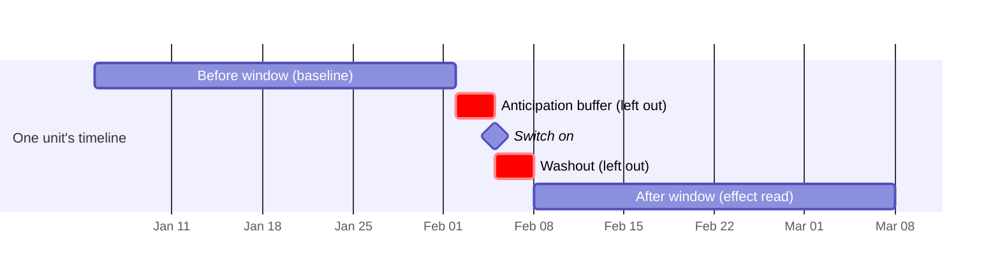
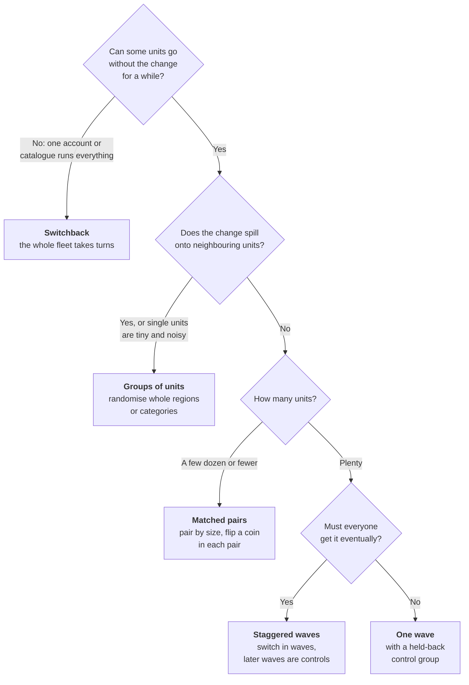
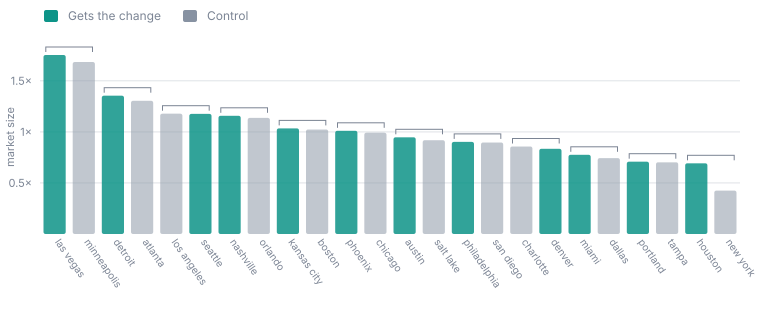

## Overview

An experiment starts as a **draft**: a description of the change, who it
applies to, what it should move and what would count as harm. You create one
with **New experiment** on the Experiments list. The draft can be edited as
often as you like until it is registered. Saving writes over the draft; if
someone else saved a newer edit since you opened it, your save is refused so
that neither edit is lost silently, and you can reload and try again.

You fill the draft in with a plain form. The form is the only way to write a
design: an experiment is a record kept by Oxygen, not a file in your
workspace, so there is nothing to import or commit.

This page walks through the form section by section, then explains how to
choose a design shape. The next step, testing the design against your
history, is [Pricing and power](/guide/build/world-model/experiments/pricing).

## What it tests

| Field | What to put there |
| --- | --- |
| **Experiment name** | A short name. It must be unique in the workspace. |
| **Hypothesis** | One sentence that could turn out false, such as *"A beverage prompt at checkout lifts beverage revenue per store-day."* |
| **Owned by** | Who receives guardrail alerts, abort notices and estimate failures, in their Inbox. Pick a workspace member (matched by email, whatever its capitals) or a team. If the owner matches nobody, notices go to the organisation's owners and admins, and say that the owner matched no one. Each notice is sent once per reason, however often the check repeats. |
| **Randomises each** | The [entity](/guide/build/semantic-model/entities) whose members are the units, such as store or market. Every unit that no wave names is a control. |
| **Randomise groups by** | Optional. A dimension of that entity, such as region or category, whose values are randomised instead of single units. See [Groups of units](#groups-of-units). |

## Outcome

| Field | What to put there |
| --- | --- |
| **Outcome measure** | The measure the experiment reads. Aim it at the **smallest** measure that contains the change; see [Choosing the outcome](#choosing-the-outcome). |
| **Only rows where** | Optional filters that narrow the measure to some rows of its view, such as one product's sales. |
| **Expected direction** | Whether you expect an increase or a decrease. This does not change the test. It lets the report say *"you predicted up, it went down"* when that happens. |
| **Driver** | Optional. A measure the lever moves directly. See [Drivers](#drivers-turning-an-effect-into-a-slope). |
| **Significance level (α)** | 0.05 for a plain test. A higher value, typically 0.2, makes a [directional](/guide/build/world-model/experiments/pricing#directional-experiments) experiment. |
| **Power** | The chance of catching an effect the size of the promised minimum. 80% is the usual choice. |
| **Outcomes registered together** | Leave at 1. If you register several outcomes as one family, the test gets stricter to make up for reading several numbers at once. |
| **Watch for cannibalisation of** | Optional. A neighbouring measure that might lose what the outcome gains. See [Cannibalisation](/guide/build/world-model/experiments/report#cannibalisation). |

### Choosing the outcome

A change adds roughly the same dollars no matter which measure you point at.
A new drink adds, say, $15 a day whether you read it in beverage revenue or
in total revenue. But total revenue is far noisier, so the same $15 is much
harder to see in it.

On a typical restaurant panel, pointing at beverage revenue instead of net
revenue let the design detect an effect **6.7 times smaller**, with the same
data and the same number of days. Lengthening the window from 28 to 84 days
bought only 1.7 times.

<Warning>
Compare designs on **dollars**, not percentages. Net revenue has the
smallest detectable effect *as a percentage*, because its baseline is so
large, which would lead you to pick the least sensitive design available.
The pricing panel ranks in absolute units for this reason.
</Warning>

### Drivers: turning an effect into a slope

Without a driver, the result is the effect of *this* change: "the promo
added $22 per shopper per day". That is a one-off, and it is not written into
the World Model.

With a driver, the experiment also measures how far the lever moved the
driver, for example "+$45 of ad spend per market-day". Dividing one by the
other gives a **slope**: dollars of outcome per dollar of driver. That slope
can be compared with the one your semantic model already holds, and, when the
measurement is solid, proposed as a correction to it. See
[Predicted against measured](/guide/build/world-model/experiments/report#predicted-against-measured)
and [Proposing a slope](/guide/build/world-model/experiments/report#proposing-a-slope-to-the-semantic-model).

A filtered outcome or driver never produces a slope proposal, because the
semantic model's edge links the unfiltered measures.

## Lever

The lever is the change, made by two automations you already have.

| Field | What it means |
| --- | --- |
| **Turned on by** and **Turned off by** | The automations that switch the change on and off for a unit. Each must name exactly one automation. Pricing and registration both check this, so a renamed or missing automation is found while the design can still be fixed, not on the switch date. |
| **How runs are made** | **One automation run for each unit and each switch**, or **one run for each wave and state, carrying all of the wave's units**. Use the second when the system you call is rate-limited, such as an ads API. |
| **At close** | **Turned off when the experiment closes**, or **Left on when the experiment closes** when the rollout is going ahead anyway and the experiment only decides the order. |
| **Confirmed on when** and **Confirmed off when** | Conditions on a measure that show in your data whether the change is really live at a unit, such as "promo redemptions above 0". |
| **Days allowed to confirm a switch** | How long a switch has to show up in the data before it counts as not landed. Always days, whatever the experiment's grain. |

### What the automation receives

Each run of a lever automation receives variables it can use to do the right
thing:

- `unit`: the unit being switched (one run per unit), or `units`: the list
  for the whole wave (one run per wave).
- `state`: `on` or `off`.
- `experiment`: the experiment's name.
- `wave`: which wave this switch belongs to.
- `members`: when units are groups, the members of the group as they were
  fixed when the run started.

Anything an automation can do can be a lever: call an HTTP API, run SQL,
start a pipeline, ask an agent. Oxygen never needs a special integration for
the system you are changing.

<Warning>
The automation must actually **use** `unit` (one run per unit) or `units`
(one run per wave); `members` also counts for a group design. An automation
that never reads them does the same thing whichever unit it is sent, so each
per-unit switch would switch the whole fleet, once per unit. Pricing and
registration both refuse such a lever and say so: *"automation `promo_on`
… never uses `{{ unit }}`, so it would do the same thing whichever units it
is sent: each flip would switch the whole fleet"*. Oxygen looks for the
variable in every template of the automation and in the SQL files it runs.
Declaring the variable is not enough; it has to be read.
</Warning>

### Why the switch is confirmed in the data

An automation finishing without an error does not mean the change is live.
A promo can be "enabled" in an API and still not show on the till. The
experiment's dates only mean something if the change really happened then,
so Oxygen checks your confirm conditions against the warehouse and records,
for each unit, whether and when the change landed. This is the
[compliance](/guide/build/world-model/experiments/running#confirming-each-switch)
record shown in the report.

<Note>
Make the grace period longer than your data's delay. If a source arrives a
week late, a two-day grace marks every switch as not landed before the data
could confirm it. Pricing warns you when it sees this.
</Note>

## Schedule

| Field | What it means |
| --- | --- |
| **Design** | **Staggered waves** (some units switch on, others stay as controls, possibly over several dates) or **Switchback** (the whole fleet alternates on and off). |
| **Time zone** | Every date in the design is a calendar date in this zone. A switch happens as that day begins there, or at its hour at hour grain. |
| **Calendar date dimension** | Optional, unless the outcome's view has several date columns. Then it must say which one the experiment's calendar runs on. |
| **Measure the outcome per** | Hour, day (the default), week or month: one reading per unit per period. Every length below then counts periods, and its label says so (**Weeks measured before each switch**). Every switch date must start a period: a Monday at week grain (weeks run Monday to Sunday), the 1st at month grain, any whole hour at hour grain. See [Hours, days, weeks and months](/guide/build/world-model/experiments/grain). |
| **Days measured before each switch** | The before window, used as each unit's baseline. |
| **Days measured after each switch** | The after window, where the effect is read. |
| **Anticipation buffer (days)** | Days just before the switch left out, in case behaviour moves early because the change was announced. |
| **Washout (days)** | Days just after the switch left out while the change settles in: staff learning a new step, a partial first day, customers not yet aware. |
| **Keep reading after it turns off** | Optional [carryover](/guide/build/world-model/experiments/report#after-the-lever-turned-off) window. Needs a single switch date and the lever turned off at close. |
| **Period length (days)** | Switchback only. How long each on and each off period lasts. |

The table uses day-grain labels. Hour is offered only when the calendar is a
datetime dimension; at hour grain a switch can fall on any whole local hour,
such as 14:00, and a switchback can alternate every few hours. The grace
period and the guardrails stay in days at every grain, and a warehouse whose
weeks start on Sunday cannot be read at week grain.
[Hours, days, weeks and months](/guide/build/world-model/experiments/grain)
explains each of these, with a worked example.

Both the buffer and the washout default to zero, and leaving either out when
it is needed biases the result **toward zero**: the washout because the
ramp-up dilutes the after window, the anticipation buffer because early
behaviour lifts the baseline. Both must be chosen before the switch, because
choosing them after seeing the data is a way of choosing the answer.

### Quality floors

| Field | Default | What happens below it |
| --- | --- | --- |
| **Days with data in each window, at least (%)** | 90% | The window is not the length that was planned, so the estimator refuses it instead of quietly reading a shorter one. |
| **Switches that must land, at least (%)** | 80% | The report warns that the number measures the *attempt* to make the change, not the change itself. |

## Guardrails

Guardrails are safety limits. Each one aborts the run when it trips, and the
change is turned off.

| Field | What it means |
| --- | --- |
| **Trips when** | **A measure looks anomalous** (judged against each unit's own history), or **A condition holds** (one threshold, such as "refund rate above 5%"). |
| **Measure to watch** and **Significance** | For an anomaly guardrail: the measure, and how unusual a reading must be before it trips. |
| **Condition** | For a condition guardrail. You can divide by a second measure to compare a ratio, such as ad spend over attributed sales. |

**Every guardrail is checked at every treated unit separately.** One store's
refunds tripling would barely move the average across the treated stores, so
an average would miss exactly the case a guardrail exists for.

<Tip>
Use **A measure looks anomalous** for anything whose size follows the unit's
size: dollars, counts, hours. Each unit is judged against its own normal
range. Use **A condition holds** for ratios, where one threshold means the same
thing at a small unit and a large one. A fixed dollar threshold set for the
median store never fires at a small store and fires every day at a large
one; pricing warns you when the largest unit's average is more than twice the
smallest's.
</Tip>

## Choosing a design shape

The right shape depends on how many units you have, whether you can hold some
back, and whether the change spills over between neighbours. You do not have
to decide alone: the pricing panel prices several shapes side by side on your
own data, so you can compare them.

### One wave with a control group

The plainest design. Some units switch on one date; the rest stay as they are
for the whole experiment and serve as the comparison. It is the simplest to
read, because every untreated unit is a control for the whole run.

### Staggered waves: everyone gets it, just not the same week

This is what operators usually do: roll the change out in waves, a few weeks
apart. It works because on any date some units have not switched yet, and
those units are the controls for the waves that went before.

Each wave is read against **only the units still untouched for the whole of
that wave's after window**, including their anticipation buffer. A unit that
has already switched is never used as a control. That restriction matters:
the obvious shortcut, comparing everyone who has switched with everyone who
has not, can under realistic conditions report an effect with the **wrong
sign**.

<Frame caption="The staggered promo from the worked examples: wave 1 on 130 days ago, wave 2 two weeks later, 24 shoppers never switched. Each wave is read in its own shaded after window against the never-switched shoppers.">
  
</Frame>

The cost of staggering is smaller than it looks. On one test panel, three
plus three staggered units with six never switched priced within 1.0 to 1.2
times the detectable effect of a twelve-against-twelve single-wave design.

<Note>
If every unit eventually switches and none is held back, the **last wave
has no controls left** and cannot be read. Pricing warns you, the report
lists it as dropped with the reason, and every other wave is still read.
Space the waves further apart than the washout plus the after window plus
the anticipation buffer, or a later wave stops being a clean control for an
earlier one.
</Note>

### Groups of units

Sometimes single units cannot carry a test:

- **Most units are tiny.** In a product catalogue, a few products sell most
  of the volume and the rest sell occasionally. Their day-to-day noise
  swamps any effect.
- **The change spills over.** An ad on one product takes sales from its
  neighbours. If a neighbour is in the control group, the control group
  shows a drop that the ad caused, and the effect is counted twice.

**Randomise groups by** solves both: whole categories, regions or brands are
switched together, so the spill-over stays on one side and the noise averages
out within each group. Each group's day is the **sum** of its members' days,
so the outcome must be something that adds up (a sum or a count, not a
ratio). Group membership is fixed when the run starts: a unit added later is
in neither group, and a unit that moves group mid-run stays where it started.

The trade-off is that the sample is now the number of groups, not units.
Pricing shows the unit and group designs side by side so you can read the
trade off the data.

<Accordion title="Example: grouping by region" icon="flask">
The example shoppers belong to 8 regions. Randomising regions instead of
shoppers, with 4 regions getting a promo and 4 not, puts every shopper in a
region on the same side. If the promo spreads by word of mouth inside a
region, the spill-over stays in the treated group. The cost shows in the
pricing: with only 8 groups, that design's detectable effect was about **$60**
per region-day, so a modest promo effect would be read as "no clear effect".
</Accordion>

### Blocks: stopping a lopsided draw

When a few units are much larger than the rest, a plain random draw can put
all of them on one side. Those few units then decide the result.
**Blocks** prevent that draw from happening: pricing sorts the units by their
recent average, cuts the list into blocks of similar size, and draws within
each block, so every block contributes to both sides. The blocks are saved
with the design so the analysis uses the same ones.

### Matched pairs: few units, such as a couple of dozen markets

**Match in pairs** is the finest blocking. Units are paired by recent
average, the two largest together, then the next two, and so on. In each pair
a coin decides which one gets the change. An odd unit out joins as a control.
It needs at least four units. It is the natural choice for geographic tests
with a few dozen markets, where a careless draw can easily be lopsided.

<Frame caption="The 24 example markets, ranked by size and paired. Las Vegas and Minneapolis are the two largest, so they form a pair, and a coin decides which gets the change. A plain random draw could instead put both, and several more of the largest markets, on the same side.">
  
</Frame>

### Switchback: the whole fleet takes turns

Some changes cannot hold a control group: one ad account runs the whole
catalogue, or a chain of six has too few stores to leave three without the
change. A **switchback** turns the change on and off for **everyone**, over
periods in a random order.

This is not the same as switching everyone on one date, which Oxygen
refuses. A single switch makes the change indistinguishable from the
calendar. A switchback switches many times, so the "on" periods are a random
sample of the calendar and are compared with "off" periods from the same
stretch.

<Frame caption="A switchback over eight weeks: four pairs, and in each pair a coin chose which week was on.">
  
</Frame>

- **Periods come in pairs.** In each pair of consecutive periods a coin
  decides which half is on. A slow drift over the run moves both halves of a
  pair together and cancels inside it.
- **Use whole weeks.** A 7- or 14-day period holds every weekday equally.
  At day grain, pricing warns when periods are not whole weeks.
- **The washout repeats at every switch**, and must be shorter than the
  period. So must the grace period, or no day of a period would be both
  settled and confirmed.
- **You need enough pairs.** At a significance level of 0.05 a switchback
  needs at least six pairs; at 0.2, four. Fewer cannot reach a result however
  large the effect, and pricing refuses them.

<Warning>
A switchback measures the **short-run effect of on against off while
alternating**, which is not the same as leaving the change on. Two things it
cannot rule out are stated in every switchback report:
**carryover** (an "on" period's effect leaking into the next "off" period,
which makes the effect look smaller) and **pull-forward** (customers buying
during an "on" period instead of later, which makes it look larger). For
something bought once a month, periods need to be longer than a month.
</Warning>

## After the draft

Once the draft describes what you want, **Price this design** tests candidate
shapes against your history. **Use this design** on a priced candidate writes
the schedule, the blocks, the random seed and the promised detectable effect
into the draft. Then **Register** locks it.

Continue with [Pricing and power](/guide/build/world-model/experiments/pricing).
