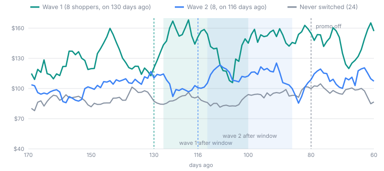
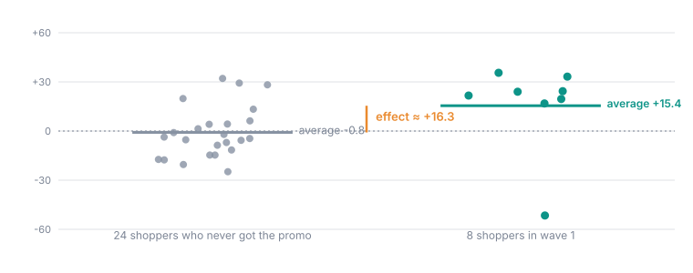
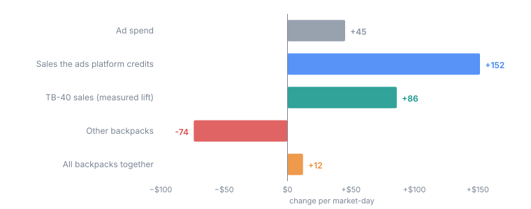
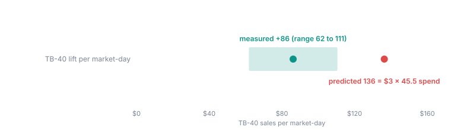
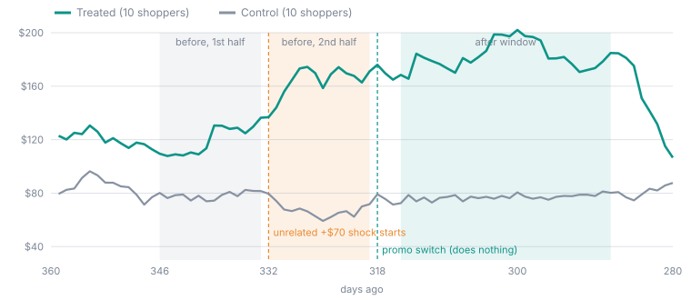
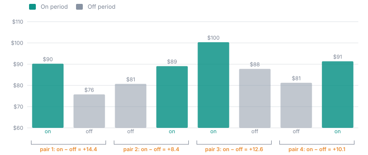

## About these examples

These runs come from Oxygen's example workspace, which is built for testing
experiments. Its data is simulated, and each run has a **known, planted
effect**. That makes it possible to check the report against the truth,
which is never possible with real data.

There are two simulated datasets:

- **Shoppers.** 80 shoppers over 420 days, one row per shopper per day. The
  average shopper-day is worth about **$90** in order value, with weekday and
  seasonal swings and a lot of day-to-day noise: one shopper-day can easily be
  half or double the next. A promo can be switched on per shopper.
- **Markets.** 24 metro markets over 420 days, selling five products. The
  Trailblazer 40L backpack (TB-40) averages about **$375** per market-day. An
  ad campaign for it can be switched on per market.

Dates are given as "days ago", because the example data always ends
yesterday.

<Note>
The numbers and charts on this page are computed from the example data with
the same comparison the report makes: each unit's after-window average minus
its before-window average, compared across groups. The report on a live
stack can differ in the last decimal place, because its random shuffles use
their own seed.
</Note>

## A staggered promo that worked

**Question:** does a promo lift order value per shopper per day?

| Design | |
| --- | --- |
| Units | Shoppers 1–40 |
| Waves | Shoppers 1–8 switch on 130 days ago; shoppers 9–16 switch on 116 days ago |
| Controls | Shoppers 17–40, never switched |
| Windows | 28 days before, 3 days washout, 28 days after |
| Promised detectable effect | **$14.74** per shopper-day at α 0.05, 80% power |
| Planted truth | **+$22** per shopper-day |

<Frame caption="Seven-day averages. Wave 1's shoppers happen to spend more than the others even before the promo, which is why Oxygen compares how much each group changed, not their levels. Each wave pulls away from the never-switched group in its own after window and falls back when the promo is turned off 80 days ago.">
  
</Frame>

**Step 1: each shopper becomes one number.** For every shopper, Oxygen takes
the average order value in the 28 days after the switch, minus the average in
the 28 days before. For wave 1, the treated shoppers changed by **+$15.4** on
average and the never-switched shoppers by **−$0.8**. Wave 1's effect is the
gap: **+$16.3**.

<Frame caption="Wave 1, one dot per shopper. Most treated shoppers rose by $15 to $35; one fell by $52. With only eight shoppers, one unlucky shopper moves the average a lot.">
  
</Frame>

**Step 2: combine the waves.** Wave 2 read **+$8.3** against the same 24
never-switched shoppers. Wave 1 is not used as a control for wave 2, because
it was already switched on. Both waves have 8 shoppers, so the combined
effect is the plain average: **+$12.30** per shopper-day.

**Step 3: is it real?** Oxygen reshuffles which shoppers were in which wave
2,000 times and recomputes the effect each time. Only 51 shuffles are as
extreme as the real result, so **p ≈ 0.026**. That is below 0.05: **Strong
evidence**. The range of effects the data cannot rule out runs from about
**$1.80 to $23.30**.

**What to take from it.** The planted effect was $22, and the report reads
$12.30. That is not a bug: with 8 shoppers per wave and this much noise, any
one run lands somewhere around the truth, and the range ($1.80 to $23.30)
does contain $22. The verdict is right, and the range tells you how far to
trust the point estimate. The total over treated units is $12.30 × 16
shoppers × 28 days ≈ **$5,500**.

## An ads campaign: real lift, smaller than the model thought, partly cannibalised

**Question:** does a Sponsored Products campaign on the TB-40 backpack earn
its spend? The campaign is geo-targeted, so the unit is a **market**.

| Design | |
| --- | --- |
| Units | 24 markets: every third market treated (8), the other 16 as controls |
| Switch | 100 days ago, off 62 days ago; 28 days before, 3 washout, 28 after |
| Outcome | TB-40 sales per market-day |
| Driver | Ad spend per market-day |
| Cannibalisation check | Sales of the other three backpacks |
| Guardrail | Ad spend ÷ attributed sales above 0.6 (a ratio, so one threshold suits every market) |
| World Model slope | **$3** of TB-40 sales per $1 of ad spend, declared by a person |
| Planted truth | Spend $45/day, TB-40 +$90/day, other backpacks −$60/day in total |

<Frame caption="How each number changed in the ad markets, compared with the markets without ads.">
  
</Frame>

**What the report shows:**

- **The effect:** TB-40 up **$86** per market-day (range $62 to $111),
  about a quarter on a $375 base. Strong evidence.
- **Cannibalisation detected:** the other backpacks fell by **$74** per
  market-day (range −$119 to −$29). Most of the lift was taken from sister
  products. The headline stays gross (+$86), with the loss stated next to it.
- **The business answer, read off the chart:** all backpacks together gained
  about **$12** a day for **$45** of ad spend.
- **Attribution over-claims.** The ads platform credits the campaign with
  **$152** a day of sales, almost twice the real TB-40 lift and over ten
  times the real gain across backpacks. Attribution counts sales that would
  have happened anyway; an experiment does not.

<Frame caption="The World Model's $3 slope, times the measured $45.5 of extra spend, predicted $136 of extra TB-40 sales. The experiment measured $86, and $136 is outside its range.">
  
</Frame>

- **Predicted against measured:** the experiment measured a slope of about
  **$1.90** of TB-40 sales per ad dollar (86 ÷ 45.5). The model's declared $3
  lies outside what the data supports, so the report reads *the experiment
  contradicts the World Model's slope*, and proposes the measured slope as a
  correction for a person to review.

**What to take from it.** A single "lift" number would have said the
campaign works. The full report says TB-40 sales did rise, but at about
two-thirds of the return the model assumed, and mostly by moving sales
between your own products.

## An honest "no clear effect"

**Question:** does free shipping lift order value?

| Design | |
| --- | --- |
| Units | Shoppers 25–34 treated, switched on 55 days ago |
| Controls | Shoppers 17–24 and 35–40 |
| Promised detectable effect | **$22.63** per shopper-day |
| Planted truth | **$0**, no effect at all |

**What the report shows.** The estimate is **+$3.85**, with a range from
about **−$13.60 to +$21.30**. Zero is comfortably inside it, so the verdict is
**No clear effect**. The **Promised effect size** check reads *Below the
promised size*: $3.85 is smaller than the $22.63 this design could detect.

**What to take from it.** The honest conclusion is "no effect large enough
for this design to see", not "free shipping does nothing". An effect of $10 a
day could hide inside that range. To rule it out, a bigger design is needed,
and pricing would say how big.

## A significant result that is wrong

**Question:** does a promo lift order value? (Nothing was planted: the promo
does nothing.)

| Design | |
| --- | --- |
| Units | Shoppers 1–10 treated, shoppers 11–20 controls |
| Switch | 318 days ago; before window 346 to 319 days ago |
| Planted truth | **$0** from the promo. But the treated shoppers get an unrelated **+$70** a day from 332 days ago, halfway through the before window, and keep it |

<Frame caption="The treated group jumps 14 days before the promo switches on. The before window's second half (orange) already carries the jump, its first half (grey) does not.">
  
</Frame>

**What the report shows.** The comparison reads **+$31.00** per shopper-day,
with a range from about $15 to $47. Taken alone, that is **Strong evidence**
for a promo that does nothing. The after window carries the whole +$70 shock,
while the before window carries it for only half its days.

The **Parallel-trends pre-check** catches it. Oxygen splits the before window
in half and runs the same comparison as if the switch had happened at the
midpoint. That fake "effect" comes out at **+$55.90**, nearly four times its
own standard error. The check reads **Diverged**, and the card carries a
**Pre-trend diverged** pill.

**What to take from it.** A significant result is only as good as the
assumption that the groups would have moved together. Read the pre-trend
check and the chart before acting on any result.

## A switchback: directional, as registered

**Question:** does the promo lift order value when no shopper can be held
back? All 40 shoppers alternate.

| Design | |
| --- | --- |
| Fleet | Shoppers 1–40, all switched together |
| Periods | 8 weeks from 250 days ago, in 4 pairs; a coin picked which week of each pair was on |
| Washout | 2 days at the start of every period |
| Significance level | **0.2**, directional, registered in advance |
| Planted truth | **+$10** per shopper-day |

<Frame caption="Each pair compares an on week with an off week next to it. All four pairs came out positive.">
  
</Frame>

**What the report shows.** The four pair differences are +14.4, +8.4, +12.6
and +10.1, so the effect is **+$11.40** per shopper-day. The test asks how
often flipping the coins could produce a result this large. With four pairs
there are only 16 ways to flip them, and two (all positive, all negative) are
this extreme: **p = 2/16 = 0.125**. That misses 0.05 but clears the
registered 0.2, so the badge reads **Weak evidence** and the verdict
*directional at α = 0.2*. The report also states the switchback's two
assumptions, carryover and pull-forward.

**What to take from it.** Four pairs can never reach 0.05, however large the
effect: the smallest possible p is 0.125. Pricing says so in advance. Here
the owner chose to register a directional test rather than run twelve weeks.

## A guardrail stops a campaign, and the report still stands

**Question:** does doubling the ad budget double the lift?

| Design | |
| --- | --- |
| Units | 8 markets treated, the other 16 controls |
| Switch | 220 days ago; after window ends 190 days ago |
| Guardrail | Ad spend ÷ attributed sales above 0.6 |
| Planted truth | Spend $90/day, TB-40 +$110/day (not double), other backpacks −$35. In Las Vegas, attributed sales collapse from 190 days ago |

**What the report should show.** The Las Vegas guardrail breaches 190 days
ago at a ratio of about 1.1. The run aborts on that breach, turns every
market's campaign off and notifies the owner. The report carries the
**Aborted run** band with the reason. Because the breach came on the last day
of the after window, the full measurement is still read. It shows about $1.20
of TB-40 sales per ad dollar against the model's $3, and nowhere near double
the lift.

**What to take from it.** Guardrails check every market separately, so one
market's collapse trips the stop even when the average across markets looks
fine. An aborted run is never presented as the registered result, but it can
still tell you a great deal.

## More cases worth knowing

| Run | Planted truth | What the report shows |
| --- | --- | --- |
| **Cannibalisation** | Promo +$22 on order value, but full-price spending −$14 | Order value **+$22.00**, full-price spending **−$11.60**: *substitution detected*. Much of the gain is shoppers buying on promo what they would have bought at full price. |
| **Low compliance** | Promo +$15 at 10 shoppers, but it only landed at 7: 2 never confirmed, 1 failed | Compliance 70%, below the 80% floor, and the promised detectable effect restated for 70%. On this data the estimate happens to come out high, about +$20, because one group of 10 is noisy. That is exactly why the report warns rather than trusting the number. |
| **Wrong direction** | Promo −$14 | About **−$19**. **Direction differs from the prediction**: *"you predicted up, it went down"*. |
| **An overstated model** | Each extra order is worth about $5; the model declared $75 | Predicted against measured: the declared $75 falls well outside the measured slope. *The experiment contradicts the World Model's slope.* |
| **Controls leaked** | Promo +$15, but half the controls got the promo too, 2 days after the switch | About **+$5.60**, a third of the truth, and not significant. The control leakage shown under compliance explains why. |
| **Too few units** | Promo +$15 with 2 treated shoppers and 2 controls | About +$8.10 with a range far too wide to say anything. Pricing had already promised only a $40 detectable effect: with 2 shoppers per group, the sample is 4, however many days the run lasts. |
| **A past flash sale** | Analysed from past data | Refused: its 28-day before window falls before the data begins. A retrospective run is held to the same rules as any other. |
| **Live and sealed** | A promo running now | Operations only: switches confirmed, coverage, next switch, guardrails. *"The result is sealed."* |
