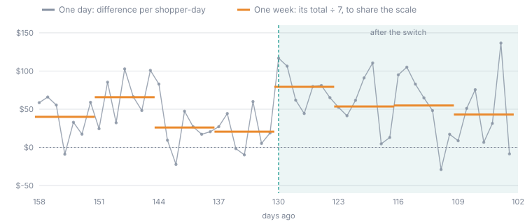
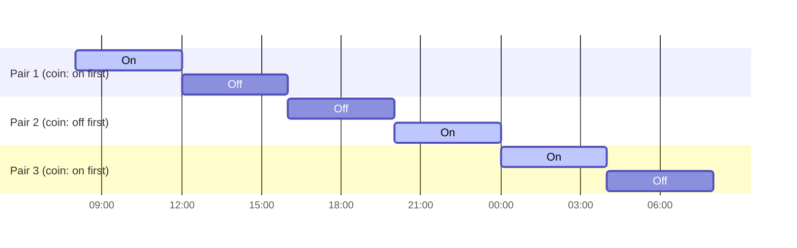

## Overview

Every experiment reads its outcome as **one number per unit per period**. The
period is the experiment's **grain**, chosen in the form under **Measure the
outcome per**:

| Grain | One reading is | Pick it when |
| --- | --- | --- |
| **Day** (the default) | A unit's outcome over one local day | Almost always. Most outcomes are recorded daily, and a day is short enough to read a change within weeks. |
| **Week (Monday to Sunday)** | A unit's outcome over one Monday-to-Sunday week | The outcome only makes sense over a week, such as weekly active customers, or most of a unit's days are empty. |
| **Month** | A unit's outcome over one calendar month | The outcome settles monthly, such as monthly revenue per account or a subscription that bills once a month. |
| **Hour** | A unit's outcome over one local hour | The change can be switched on and off within a day, such as a pricing rule at lunchtime, and the data has a time of day. |

The grain changes the unit the answer is stated in (per shopper-day, per
shopper-week), the way every window and date is counted, and, at hour grain,
when the lever can be switched. It does not change the analysis. The
statistics on [How the statistics work](/guide/build/world-model/experiments/statistics)
run exactly the same way at every grain.

## What changes with the grain

### Every length counts periods

Every window and buffer in the design counts periods of the grain. The form's
labels follow the grain, so at week grain the schedule asks for **Weeks
measured before each switch**, **Weeks measured after each switch**,
**Anticipation buffer (weeks)**, **Washout (weeks)** and **Period length
(weeks)**, and the pricing panel asks for **Spacing between waves (weeks)**.

| Setting | At day grain | At week grain | At hour grain |
| --- | --- | --- | --- |
| Before window of 4 | 4 days | 4 weeks (28 days) | 4 hours |
| Washout of 1 | 1 day | 1 week | 1 hour |
| Switchback period of 2 | 2 days on, 2 days off | 2 weeks on, 2 weeks off | 2 hours on, 2 hours off |

### Every switch date starts a period

A switch has to fall where a period begins, or the period it falls in would
mix days with the change and days without it into one reading. So:

- at **week** grain every switch date is a **Monday**;
- at **month** grain every switch date is **the 1st**;
- at **day** grain any date works, and the switch happens as that day begins
  in the design's time zone;
- at **hour** grain a switch can be any **whole local hour**, such as 14:00.

The form and the pricing panel say what the date must be next to the field
(*"Pick a Monday: at week grain every date starts a week."*), and pricing
refuses a first date that is not a period start, naming the next date that
is.

### The answer is stated per unit-period

The headline, the totals, the substitution floor, the carryover reading and
pricing's detectable effects all read per unit-week or per unit-month at
those grains. The day-by-day chart becomes **Week by week** or **Month by
month**, with a 3-week or 3-month average drawn over the raw line instead of
a 7-day one, and **Hour by hour** with a 24-hour average at hour grain.

### Partial periods are never read

A period that has not finished yet, such as the current week on a Wednesday,
is never read, by pricing, by the [interim reading](/guide/build/world-model/experiments/running#peeking-the-interim-reading)
or by the final estimate. Reading three days of a week as if they were a week
would make that week look small. The data coverage floor also counts periods:
a window of 4 weeks needs at least 90% of its weeks to have data.

## Worked example: the same promo by day and by week

The staggered promo in the [worked examples](/guide/build/world-model/experiments/examples#a-staggered-promo-that-worked)
switched 8 shoppers on 130 days ago, against 24 shoppers who never got it.
Take the four weeks either side of that switch, with no washout, and compare
the two groups.

<Frame caption="Wave 1 minus the never-switched shoppers, 28 days either side of the switch. Grey: one reading per day. Orange: one reading per week, divided by 7 so both share a scale. A weekly reading smooths out the weekday swings and the days with no order (12% of shopper-days in this data).">
  
</Frame>

| Read per | Before (average gap) | After (average gap) | Effect |
| --- | --- | --- | --- |
| Day | 28 daily readings | 28 daily readings | **+$19.61** per shopper-day |
| Week | 4 weekly readings | 4 weekly readings | **+$137.25** per shopper-week |

$137.25 is exactly 7 × $19.61. That is not a coincidence: the analysis
averages each unit's readings over each window before comparing anything (see
[Why one number per unit matters](/guide/build/world-model/experiments/statistics#why-one-number-per-unit-matters)),
and on a measure that adds up, such as order value, the average of 4 weekly
totals is 7 times the average of the same 28 days. On a measure that adds up
and has data every day, **the grain changes the unit of the answer, not the
answer**.

The grain does change the answer in three cases, and these are the reasons to
pick it:

1. **The measure does not add up over days.** Weekly active customers are not
   the sum of daily active customers: a customer who shops on Monday and
   Thursday counts once in the week and twice across the days. Read such a
   measure at the grain it is defined at.
2. **Most days are empty.** A ratio such as average order value has no value
   on a day with no orders, so at day grain those days are missing. A day
   missing for any unit is dropped for every unit, and enough of them push a
   window below the coverage floor. A week almost always has an order.
3. **Dates and windows must line up with how the business works.** A monthly
   price change belongs on the 1st, and a window of "3 months" is clearer
   than "92 days".

<Note>
A coarser grain leaves fewer readings in each window, so each one weighs more.
In a 4-week window one missing week is 25% of the window, below the 90%
coverage floor, so every week must have data. Pricing also needs at least two
non-overlapping stretches of history long enough for the whole design: a
design with 3 months before and 3 months after needs about a year of history
at month grain. Pricing shows what each choice can detect, on your data,
before anything moves.
</Note>

## What stays daily, and why

Some parts of a run watch the lever and the safety measures **while it is
live**, not the outcome. They stay in days at every grain, because a week or
a month is far too long to wait before noticing that a switch never happened
or a guardrail has tripped:

| Part | Unit at every grain |
| --- | --- |
| **Days allowed to confirm a switch** (the grace period) | Days |
| **Guardrails**, including the spread a condition guardrail looks back over | Days |
| How late the confirm and guardrail data arrives (pricing's warnings) | Days |
| The World Model slope pricing records for a driver | Fitted on daily history |

At hour grain the switch confirmation itself is read hour by hour (see
below), but how long a switch has to show up is still counted in days.

## Weeks start on Monday

Oxygen's weeks run Monday to Sunday, in the design's time zone. Some
warehouses, including BigQuery and MySQL, start a week on Sunday by default.
Read at week grain, their week would mix the Sunday before a Monday switch
with the six days after it. When the warehouse returns a week that does not
start on a Monday, the read is refused: *"at week grain every period must
start on a Monday, so this measure cannot be read at week grain here. Use a
different grain"*. Day and month grain read correctly on those warehouses.

## Hour grain: switching at any hour

Hour grain is offered only when the outcome's calendar is a **datetime**
dimension. A date column has no hour to read, so the picker leaves **Hour**
out, and pricing refuses an hour design on one.

### Switches on the hour

At hour grain the first switch date and every wave and period date take a
date and a time, such as 26 October 2026 at 14:00. A date without a time
means midnight. Every switch must be on the hour; 14:30 is refused.

A switchback can then alternate within a day. With a period length of 4, the
whole fleet switches every 4 hours, in randomised on/off pairs:

The same rules as at day grain apply: the washout repeats at every switch and
must be shorter than the period, and enough pairs are needed to reach the
significance level.

<Warning>
Hourly outcomes swing much more across the day than daily outcomes do across
the week. A lunchtime hour and a 3 a.m. hour are very different readings, and
an on period that holds more busy hours than its off partner reads as an
effect. Choose a period length that holds the same hours in both halves of a
pair, such as 12 or 24 hours, or check pricing's detectable effect for the
shorter period before choosing it.
</Warning>

### What happens at each hour

| Step | At hour grain |
| --- | --- |
| **Registration deadline** | The switch moment less the anticipation buffer in hours. A design switching at 14:00 with a 2-hour buffer must be registered before 12:00 that day. |
| **Switching** | A switch is due once the local hour reaches it. The scheduler wakes at the switch moment itself. |
| **Confirming the switch** | The confirm conditions are read hour by hour, so a 4-hour off period is judged on its own hours. The grace period is still in days. |
| **Closing** | The run closes at the hour its last after window ends. |
| **Guardrails** | Still checked against daily readings, up to yesterday. |
| **An abort part-way through a day** | The measurement stops at the start of that day: only whole days before the abort are read. |

<Note>
Hour-by-hour confirmation needs a confirm measure that has a time of day.
If a **Confirmed on when** or **Confirmed off when** measure is read on a
date column, no switch inside a day could ever be confirmed. Pricing warns
about it and names the measure.
</Note>

A switch at a local hour that does not exist, such as 02:00 on the night
clocks go forward, happens at the first moment after it.

<Accordion title="Under the hood: one number per period" icon="gear">
The warehouse is queried at the grain's granularity (hour, day, ISO week or
month) in the design's time zone. Oxygen then numbers every period with one
consecutive whole number, so a window of 4 periods is always 4 numbers apart,
whatever the grain, and the analysis is the same code at every grain. A
month is one number whether it has 28 or 31 days.

At day grain the number is the same day count the platform always used, so a
day-grain design reads, hashes and analyses exactly as designs did before
grains existed. A switch at midnight is stored as a plain date for the same
reason.
</Accordion>
