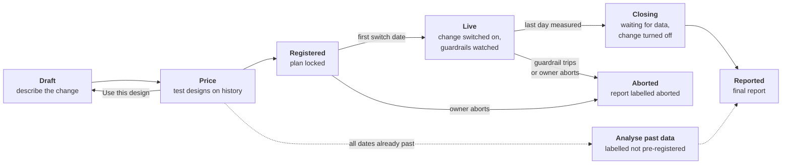

## Overview

An **experiment** answers one question: *did the change we made cause this,
or would it have happened anyway?*

Say you turn on a promotion and sales go up. They might have gone up because
of the promotion, or because it was payday week, the weather was good, or a
competitor closed. Looking at sales before and after the change cannot tell
these apart. Oxygen can, because it compares places where the change was made
against places where it was not, over **the same days**. Anything that hit
every place on those days, such as the season, a holiday or a national ad
campaign, affects both groups equally and cancels out. What is left is the
effect of the change.

Experiments live in the IDE under **Experiments** (the flask icon in the
rail). Each experiment has one page, and what that page shows depends on how
far along the experiment is.

<Note>
Experiments are built on the [semantic model](/guide/build/semantic-model/views)
and on [automations](/guide/build/automations/index). The thing you measure is
a measure you already have, and the change itself is made by an automation you
already wrote. Oxygen supplies the design, the schedule, the checks and the
statistics around them.
</Note>

## What the platform does for you

Running a fair experiment by hand is hard to do well, and it is easy to fool
yourself without meaning to. Oxygen takes over the parts where people
usually go wrong.

1. **It checks the design before anything moves.** Before you commit, Oxygen
   tests the design against your own history and tells you the smallest
   effect it could detect. If the design cannot work at all, it says so and
   explains why. This is called **pricing** the design.
2. **It decides who gets the change.** Oxygen picks the places that get the
   change by a recorded random draw, so nobody can, even by accident, give it
   to the places that were going to do well anyway.
3. **It locks the plan.** When you **Register**, the design can no longer be
   edited. The report is then judged against the plan that was written before
   any results existed, so nobody can choose a convenient answer afterwards.
4. **It makes the change on schedule.** On each switch date, or at any
   whole hour when the experiment is measured hour by hour, Oxygen runs your
   automation for the right places, then checks in your data that the change
   actually happened.
5. **It watches for harm.** Safety limits you set, called **guardrails**, are
   checked every hour while the change is live. If one trips, the experiment
   stops and the change is turned off.
6. **It keeps the answer sealed until the end.** The registered result is
   computed once, when the run is over. While it runs you can peek at an
   **interim reading**, clearly badged *Interim, not final*, but it never
   becomes the result and never changes the run. Checking early and stopping
   when the number looks good is one of the most common ways experiments
   produce false results.
7. **It writes an honest report.** At the end you get the effect with its
   uncertainty, plus the checks that tell you how far to trust it: whether the
   change really landed, whether the groups behaved alike before the change,
   and whether the gain was taken from a neighbouring product.
8. **It can teach the World Model.** When the experiment measured how strongly
   one measure drives another, Oxygen can propose that number as a change to
   your semantic model, for a person to review and merge.

## The life of an experiment

| Stage | What you see on the page | Read more |
| --- | --- | --- |
| **Draft** | The design form, and a pricing panel that compares candidate designs side by side | [Designing an experiment](/guide/build/world-model/experiments/design) |
| **Priced** | Each candidate's smallest detectable effect, or the reason it cannot work | [Pricing and power](/guide/build/world-model/experiments/pricing) |
| **Registered** | The locked plan and the date of the first switch | [Running an experiment](/guide/build/world-model/experiments/running) |
| **Live** | Operations: switches sent and confirmed, data coverage, guardrails, and an interim reading badged *Interim, not final*. The registered result is sealed | [Running an experiment](/guide/build/world-model/experiments/running) |
| **Closing** | The change is turned off; Oxygen waits for the last days of data to arrive | [Running an experiment](/guide/build/world-model/experiments/running#closing) |
| **Reported** or **Aborted** | The report | [Reading the report](/guide/build/world-model/experiments/report) |

Measuring per hour, week or month instead of per day, and switching at any
hour, are on [Hours, days, weeks and months](/guide/build/world-model/experiments/grain).
How the numbers are calculated, in plain words first and with the formulas
folded away, is on [How the statistics work](/guide/build/world-model/experiments/statistics).
Reading designs whose dates are already past, and designs for very few
places, are covered in
[Past data and few-unit designs](/guide/build/world-model/experiments/past-data-and-few-units).
[Worked examples](/guide/build/world-model/experiments/examples) walks
through real runs from start to finish.

## Three rules behind every decision

Most of what Oxygen does, and most of what it refuses to do, follows from
three rules.

<AccordionGroup>
  <Accordion title="1. Compare like with like, on the same days" icon="scale-balanced">
    An effect is only measurable if some places did **not** get the change on
    the same days. If every store switches on the same morning, the change and
    the calendar are the same thing, and no analysis can pull them apart
    afterwards. Oxygen therefore **refuses** a design where every unit
    switches on one date. It suggests a staggered rollout or a
    [switchback](/guide/build/world-model/experiments/design#switchback-the-whole-fleet-takes-turns)
    instead, which are the honest ways to roll a change out everywhere.
  </Accordion>
  <Accordion title="2. Write the plan down before the data exists" icon="lock">
    What counts as a fair result depends on what you said you would test
    *before* you looked. The design, the measure, the windows and the
    significance level are all locked at registration, and the report is
    graded against them. A design written after its data existed can still
    be analysed, but its report says, every time, that it is exploratory and
    not pre-registered.
  </Accordion>
  <Accordion title="3. Refuse rather than guess" icon="hand">
    When a design cannot answer the question, the most useful thing Oxygen can
    do is say so before you spend weeks running it. A refusal names what was
    tested and why it failed. It is the main content of the page, not an
    error. The same applies in the report: an interval that cannot be bounded
    is reported as unbounded, never invented.
  </Accordion>
</AccordionGroup>

## Glossary

The words below appear throughout these pages and in the product.

| Term | Meaning |
| --- | --- |
| **Unit** | The thing that gets the change or not: a store, a market, a shopper, a product. In the form this is **Randomises each**. |
| **Group** | A set of units randomised together, such as every store in a region. Used when single units are too small or too noisy, or when the change would spill over between neighbours. In the form: **Randomise groups by**. |
| **Lever** | The change itself. It is two [automations](/guide/build/automations/index): one that turns the change on for a unit and one that turns it off. |
| **Outcome measure** | The number you expect the change to move, such as beverage revenue per store per day. Also called the target. |
| **Grain** | The period one reading covers: an hour, a day (the default), a week or a month. Every window counts periods of the grain. In the form: **Measure the outcome per**. |
| **Driver** | Optional. A measure the lever moves directly, such as ad spend or number of orders. Lets the report say *how much outcome you get per unit of driver*. |
| **Cannibalisation check** | Optional. A neighbouring measure watched for losses, such as sales of the other backpacks when one backpack is advertised. Also called the substitution check or sibling. |
| **Guardrail** | A safety limit checked during the run. If it trips at any unit, the experiment stops. |
| **Treated** and **control** | Treated units get the change; control units do not. The control units show what would have happened without it. |
| **Wave** | A set of units that switch on the same date (or hour). A staggered rollout has several waves. |
| **Switchback** | A design where the whole fleet alternates between on and off over randomised periods, instead of holding a control group. |
| **Blocks** and **matched pairs** | Units sorted by size and grouped, so the random draw cannot put all the big units on one side. Matched pairs is the finest version: units are paired by size and one of each pair gets the change. |
| **Before window** and **after window** | The periods measured before and after each switch. In the form: **Days measured before each switch** and **Days measured after each switch** (weeks, months or hours at those grains). |
| **Anticipation buffer** | Days just before the switch that are left out, because people may change behaviour once a change is announced. |
| **Washout** | Days just after the switch that are left out, while the change settles in. |
| **Carryover** | Optional. Days read after the lever turns off at the end, to see whether the effect lingered. |
| **Coverage** | The share of a window's days that actually have data. Below the floor, a window does not count as the length that was planned. |
| **Compliance** | The share of switches that were confirmed in the data. A switch that was sent but never showed up in the data does not count as landed. |
| **Grace period** | How many days a switch has to show up in the data before it counts as not landed. In the form: **Days allowed to confirm a switch**. |
| **Minimum detectable effect (MDE)** | The smallest effect a design can reliably detect. A smaller real effect will usually read as "no clear effect". |
| **Significance level (α)** | How often you accept a false alarm. 0.05 means a 1 in 20 chance of seeing an effect that is not there. |
| **Power** | How often the design catches an effect exactly the size of the MDE. 0.80 means 4 times in 5. |
| **Directional** | A result tested at a looser significance level chosen in advance, usually 0.2. It shows which way the effect points, not a firm result. |
| **Pricing** | Testing candidate designs on your history to find each one's MDE, or the reason it cannot work. |
| **Registration** | Locking the design. It must happen before the first switch (less the anticipation buffer), and it cannot be undone. |
| **Sealed** | The state of the registered result while the run is live: it is not computed and cannot be read. |
| **Interim reading** | The registered analysis run over the days finished so far, on a live or closing run. Badged *Interim, not final*; never the result. |
| **Intention to treat** | Units are analysed in the group they were assigned to, whether or not the change really landed there. This keeps the comparison fair; the report shows compliance next to it. |
| **Parallel trends** | The assumption that treated and control units would have moved together without the change. The report checks it on the days before the switch. |
| **Gross effect** | The measured effect on the outcome, before taking anything from neighbouring measures into account. Oxygen never reports a "net" figure, for reasons explained in [the report](/guide/build/world-model/experiments/report#cannibalisation). |
| **World Model slope** | A coefficient on a driver edge in your semantic model, such as "$3 of sales per $1 of ad spend". The report compares it with what the experiment measured. |
| **Retrospective** | An analysis of a design whose dates have all passed. Always labelled *not pre-registered*. |
