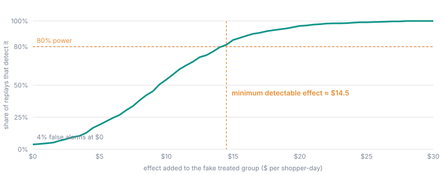

## Overview

**Pricing** answers the question to ask before running anything: *if the
change works, would this design be able to tell?*

Every design has a **minimum detectable effect (MDE)**, the smallest effect
it can reliably pick up. If you expect a promo to add about $5 per store per
day and the design can only see $20, running it would most likely end in "no
clear effect", even if the promo works. Pricing tells you that in advance,
using your own data, so you can change the design (a smaller outcome measure,
longer windows, more units, groups, pairs, a switchback) or drop the idea.

Sometimes the answer is that a design **cannot work at all**, for example
because every unit switches on the same day. Pricing then **refuses** it and
says why. A refusal is the most valuable thing pricing can tell you: no
analysis afterwards can rescue a design like that.

## Pricing a draft

On a draft, the pricing panel lets you describe up to **six candidate
designs** and price them in one go. Each candidate is either:

- **Staggered waves**, with **Wave sizes**, **First switch date**,
  **Spacing between waves (days)**, optional **Blocks**, optional **Assign
  by a dimension** (groups), or **Match in pairs** instead of wave sizes; or
- **Switchback**, with **First period starts**, **Period length (days)** and
  the number of **Pairs**.

A new candidate starts in the draft's own shape: a switchback draft's
candidates start as switchbacks. The lengths count periods of the draft's
[grain](/guide/build/world-model/experiments/grain), and their labels say so
(**Spacing between waves (weeks)**). The first date must start a period: a
Monday at week grain, the 1st at month grain, and at hour grain a date and a
whole hour. A switchback's **Pairs** must be enough for its significance
level to be reachable at all (at least 6 at 0.05, 4 at 0.2, and 6 for
**Both**); the form says so next to the field before anything is queued.

For each candidate you also choose the significance level: **0.05**,
**0.2 (directional)**, or **Both**, which prices the candidate twice.

Pricing runs in the background, because each candidate means running the
real analysis thousands of times on your history (see below). The candidates
then appear side by side, ranked by their detectable effect.

### What pricing reads

Pricing reads the outcome measure for every unit and every finished period
of history before today, at the draft's grain, from the workspace's promoted
model (never an unsaved working
copy), at the access level of a workspace viewer. In the same pass it reads
what it needs for its warnings: how late each confirm and guardrail measure's
data arrives, each condition guardrail's average per unit, and, when the
draft names a driver, the slope your World Model holds for it.

Before reading anything, it checks that both lever automations exist, are
unambiguous, and read the units they are sent. A design whose lever cannot
move, or would move the whole fleet at every switch, is not worth pricing.

## How the minimum detectable effect is found

Oxygen does not use a textbook formula. It replays the experiment on your
own history, many times, where nothing was changed.

<Steps>
  <Step title="Pick a fake switch date in the past">
    A random date in your history, early enough that the whole design (the
    before window, the buffers, the after window and, for staggered designs,
    every wave) fits before today.
  </Step>
  <Step title="Draw a fake treated group">
    The same way the real draw will be made: the same wave sizes and spacing,
    the same blocks or pairs, the same groups. For a switchback, the pair
    schedule is slid to that date and each pair's coin is flipped again.
  </Step>
  <Step title="Run the real analysis">
    The exact test the final report will use, with its own decision rule.
    Since nothing actually changed on that date, this shows how big a
    "result" pure noise can produce.
  </Step>
  <Step title="Add a pretend effect and see if it is caught">
    Add an effect of a given size to the fake treated units and check whether
    the analysis declares it. Repeat over many fake dates and draws, and
    search for the smallest effect that is caught as often as the chosen
    power (for example 80% of the time).
  </Step>
</Steps>

<Frame caption="A placebo power curve on a simulated panel shaped like the example shoppers: 40 shoppers, 16 treated and 24 controls, 28-day windows. With nothing added, 4% of replays raise a false alarm (the 5% budget). An effect of about $14.50 is caught 80% of the time, which makes it the minimum detectable effect. The staggered promo in the worked examples was priced at $14.74.">
  
</Frame>

That smallest effect is the MDE. Because it comes from your data, it already
reflects your weekly patterns, your seasons, how noisy your units are, and how
much each unit's days resemble each other. A workspace with few units or
heavy seasonality gets an honest, larger number instead of a formula's
optimism.

<AccordionGroup>
  <Accordion title="Why replay instead of a formula?" icon="calculator">
    - **No assumptions about the shape of your data.** The placebo uses the
      real distribution, skew and outliers included.
    - **Day-to-day correlation is already handled.** A store's Tuesday looks
      like its Monday. The analysis averages each unit's days into one number
      per window, so there is no correlation parameter to estimate and get
      wrong.
    - **It doubles as a false-alarm check.** With no effect added, the
      replay shows how often the design would cry wolf on your data.
    - **It prices the test that will actually run.** An earlier
      approximation priced a slightly different statistic and promised 80%
      power where the real test delivered about 75%. Each draw now runs the
      final decision rule itself.
  </Accordion>
  <Accordion title="How many replays, and how independent are they?" icon="repeat">
    A single-wave design is replayed 2,000 times, a staggered design 300 times
    (each replay runs a full permutation test inside it, which is expensive),
    and a switchback 1,000 times. At least half the replays must produce a
    usable comparison, or the candidate is refused.

    The replays are drawn only from history before the design's first switch.
    Drawn from later dates, some would overlap the real change and inflate
    the noise. Pricing also requires at least **two non-overlapping
    stretches** of history long enough for the whole design. Many replays
    over a short history are not many independent looks, and the result
    reports how many distinct start dates it used.
  </Accordion>
  <Accordion title="The maths, for the curious" icon="square-root-variable">
    For a single wave, each replay computes the estimate and its standard
    error `se`, then asks whether an effect `τ` would be declared:
    `|t + τ / se| ≥ t_crit(df, α, family)`, using that replay's own Welch
    degrees of freedom and the registered number of outcomes. Power at `τ` is
    the share of replays that clear the bar. For staggered and switchback
    designs the effect is added to the data itself and the full
    randomisation test is run on each replay. The MDE is then found by
    doubling `τ` from the noise level until power is reached and bisecting
    back down.
  </Accordion>
</AccordionGroup>

<Accordion title="Example: reading three candidates side by side" icon="flask">
Pricing the example shoppers with three candidates might show:

| Candidate | Detectable effect | What it tells you |
| --- | --- | --- |
| Staggered, waves of 8 and 8, 14 days apart | **$14.74** per shopper-day | Ranked first. A promo worth around $15 or more would probably be caught. |
| Switchback, 4 weekly pairs, α 0.2 (directional) | about $13 | Comparable, but only directional, and it can never reach 0.05 with 4 pairs. |
| Single wave of 2 against 2 | about $40 | Too small to be useful: it would miss anything but a huge effect. |

Expecting a promo worth about $10, none of these would reliably see it. The
cheapest fixes are a narrower outcome measure, longer windows or more
shoppers. Pricing shows the number for each change before anything moves.
</Accordion>

## Ranking candidates

Candidates are ranked by their MDE in **dollars per unit-day** (or whatever
the outcome's unit is; per unit-week, unit-month or unit-hour at those
grains), lowest first. Two adjustments put different shapes on
one scale:

- A **group** design's own MDE is per group-day. For the ranking it is
  divided by the average group size, which assumes the effect spreads evenly
  over a group's members. The panel says so next to it.
- A **switchback's** MDE is already an average per unit-day across the
  fleet.

<Note>
The promised effect saved into a group design when you use it is on the
group's own scale, per group-day, because that is what the analysis
measures. Only the ranking divides it.
</Note>

## Directional experiments

"It only needs to be roughly right" has an honest version and a dishonest one.

- **Dishonest:** run at 0.05, get a result that is not significant, and read
  its sign as a finding anyway. The false-alarm rate is then whatever the
  reader wants it to be.
- **Honest:** decide *before the switch* to accept a higher false-alarm
  rate, typically 0.2 (one in five). In exchange, the same data can see an
  effect about a quarter smaller.

Choosing **0.2 (directional)** or **Both** shows you that trade as two
numbers. The report then calls a result that clears the looser bar
**directional**, never plainly significant. A looser significance level does
**not** rescue a design that cannot identify the effect at all. No setting
separates a change from the calendar it coincides with.

<Accordion title="Where 'about a quarter smaller' comes from" icon="square-root-variable">
By the usual normal approximation, the detectable effect scales with
`z(1 − α/2) + z(power)`. At 80% power that is `1.28 + 0.84` at α 0.2 against
`1.96 + 0.84` at α 0.05, a ratio of about 0.76.
</Accordion>

## Refusals

A refused candidate shows the reason in place of a number. The common ones:

| Refusal | What it means and what to do |
| --- | --- |
| **Every unit is in one wave** | The whole fleet would switch on one date, so the change is the calendar. Hold some units back, stagger over two or more dates, or use a switchback. |
| **The lever cannot move** | An automation named for the lever does not exist, or more than one matches. Fix the name. |
| **The lever never reads its units** | The automation never uses `unit` (or `units`, or `members` for groups), so every switch would switch the whole fleet. Make the automation act on the unit it is sent. |
| **The first date does not start a period** | At week grain it is not a Monday, at month grain not the 1st, at hour grain not a whole hour, or at day grain it has a time of day. The refusal names a date that would work. |
| **Hour grain on a date calendar** | The outcome's calendar is a date with no time of day, so there is no hour to read. Name a datetime calendar, or use day grain. |
| **Weeks do not start on Monday** | The warehouse returned a week starting on another day (BigQuery and MySQL start on Sunday). Use day or month grain. |
| **No history** | The outcome measure returned no rows for these units. Check the measure, the entity and any filters. |
| **Not enough history** | Fewer than two non-overlapping stretches of history fit the whole design. Shorten the windows or wait for more data. |
| **Cannot reach the significance level** | With this few units, waves or pairs, no assignment could ever produce a small enough p-value, however large the effect. Add units or pairs, or register a directional level. |
| **Too few units in a wave or block** | Every wave, arm and block needs at least two units; matched pairs need at least four units in all. |
| **Groups need an outcome that adds up** | A ratio cannot be summed over a group's members. Use a sum or count measure. |
| **Ambiguous or missing date column** | The outcome's view has several date columns (choose one in **Calendar date dimension**) or none. |
| **The draft changed** | The draft was edited after pricing was requested. Price it again. |
| **Switchback rules** | A switchback has no before or after windows, blocks or groups; its washout and grace period must be shorter than the period. |

## Warnings

Warnings do not stop you. They point at something that will probably hurt
the result.

| Warning | Why it matters |
| --- | --- |
| **Washout is 0** | Day grain only. The change starts as the switch day begins, so a partial first day lands in the after window and waters the effect down. |
| **The last wave is not estimated** | Every unit eventually switches, so the final wave has no controls left. |
| **Confirm data arrives too late** | The confirm measure lags by at least the grace period, so switches will read as not landed before the data could confirm them. |
| **Guardrail data arrives late** | A guardrail measure lags by more than a day, so it can only see a breach that late. The warning says how late. |
| **Condition guardrail spans unit sizes** | The largest unit's average is more than twice the smallest's, so one threshold sits at a different place for each. Consider **A measure looks anomalous**. |
| **Periods are not whole weeks** | Day-grain switchback only. Weekday swings stay in the noise and the detectable effect grows. |
| **Confirm measure has no time of day** | Hour grain only. A confirm measure read on a date column could never confirm a switch inside a day. |
| **Switchback assumptions** | Always shown on a switchback: it measures the short-run on/off effect, subject to carryover and pull-forward. |
| **Group effect divided by group size** | The ranking assumes the effect spreads evenly over a group's members. |
| **No World Model slope recorded** | The draft names a driver, but there was no usable slope to compare against: no driver edge, a non-linear one, a filtered measure, or a fit that failed. |
| **Registration deadline already passed** | The first switch date is too close to register in time. Move the date. |

## Every draw is logged

Each candidate is drawn with a fresh random **seed**, recorded with it, so
anyone can reproduce the exact split. But a seed only proves the split can be
reproduced, not that it was the first one drawn. Drawing again and again until
the big stores land in the treated group is a quiet way of choosing the
answer.

So Oxygen keeps every priced candidate in a log, and the report's
**Randomisation** check states how many designs were priced before the one
that was registered. Re-pricing is fine, since drafts legitimately change,
but it is never invisible. Only candidates that priced successfully count;
refusals and faults do not.

## Using a design

**Use this design** writes the priced candidate into the draft: the waves or
switchback periods, the blocks, the groups, the seed, the significance level
if you changed it, the promised detectable effect and the World Model slope
it found. If the draft has been edited since that candidate was priced, the
button is replaced by *"The draft changed after this was priced. Price it
again to use it."*, because the schedule belongs to the design it was drawn
for.

The draft is then ready to register. The registration deadline is the start
of the first switch day, less the anticipation buffer, in the design's time
zone (at hour grain, the first switch hour less the buffer in hours). Continue with [Running an experiment](/guide/build/world-model/experiments/running).
