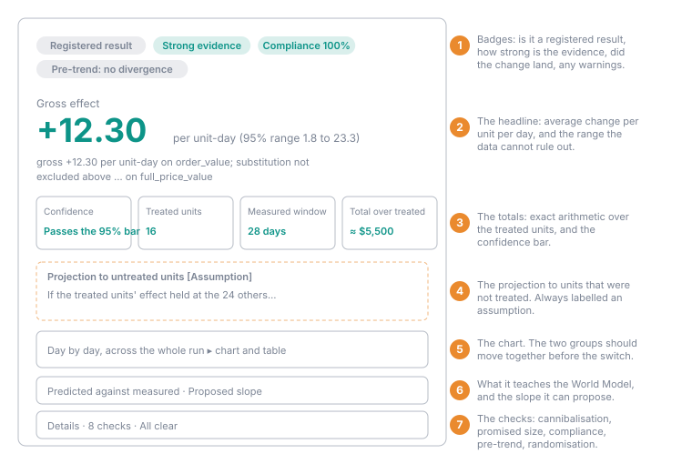
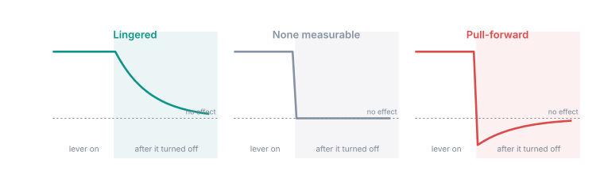

## Overview

When a run is reported, or aborted, its page becomes the report. It is
computed once, from the data the run measured, and stored with the run. Read
again a year later, it shows exactly the same page.

The report is built to answer three questions in order:

1. **What happened?** The effect, its uncertainty, and what it adds up to.
2. **How far can I trust it?** Did the change land, did the groups behave
   alike beforehand, was the gain taken from somewhere else?
3. **What does it teach the model?** How the measurement compares with what
   your World Model expected, and whether to update it.

The page has a summary card at the top, then the day-by-day chart, then the
World Model sections, then a folded **Details** list of checks. The details
header shows how many checks need review, or **All clear**.

<Frame caption="The summary card, annotated. The numbers are the staggered promo from the worked examples.">
  
</Frame>

Every section below ends with an example from the
[worked examples](/guide/build/world-model/experiments/examples), where the
true effect is known.

## The summary card

### The verdict badge

| Badge | Meaning |
| --- | --- |
| **Strong evidence** | The effect is significant at the registered level of 0.05 or below. |
| **Weak evidence** | The effect clears a looser, **directional** level registered in advance, such as 0.2. It shows which way the effect points; it is not a firm result. |
| **No clear effect** | The effect cannot be told apart from zero at the registered level. |
| **Estimator refused** | The analysis could not be run on this data. The reason replaces the numbers. |

Hover the badge to see the exact verdict, such as *"significant at
α = 0.05"*. The **Confidence** tile shows whether the result passes the bar
and its p-value: the chance of seeing an effect at least this large if the
change actually did nothing.

<Accordion title="Example: three verdicts" icon="flask">
- **Strong evidence.** The staggered promo read **+$12.30** per shopper-day.
  Reshuffling who got the promo 2,000 times produced a result that large only
  51 times, so p ≈ 0.026, below 0.05.
- **Weak evidence.** The switchback registered α = 0.2 in advance. Its four
  pairs all came out positive, p = 0.125: not enough for 0.05, enough for the
  registered 0.2. The verdict reads *directional at α = 0.2*.
- **No clear effect.** Free shipping read **+$3.85**, with a range from
  −$13.60 to +$21.30. Zero is inside the range.
</Accordion>

<Note>
**"No clear effect" is not "no effect".** It means this design could not
distinguish the effect from zero. The **Promised effect size** check tells
you which: if the measured effect is smaller than the smallest effect the
design promised to detect, a real but small effect could still be there.
</Note>

### The headline

The large number is the **gross effect**: the average change in the outcome
per unit per day (per unit-hour, unit-week or unit-month at those
[grains](/guide/build/world-model/experiments/grain)), with its interval
underneath. The sentence under it reads
like this (the numbers are illustrative):

> gross +12.30 per unit-day on shopper_days.order_value (±10.75);
> substitution not excluded above 9.80 per unit-day on
> shopper_days.full_price_value

The **±** is the 95% interval (or whatever the registered level gives): the
range of effects the data cannot rule out. When the data cannot bound it on
one side, the report says **interval unbounded** instead of inventing an
edge.

<Accordion title="Example: reading the headline" icon="flask">
The staggered promo's headline says the promo added **$12.30** per shopper
per day, and that anything from about **$1.80 to $23.30** is consistent with
the data. The true, planted effect was $22: inside the range, though well
above the point estimate. With 8 shoppers per wave, the point estimate is a
best guess, and the range is the honest statement.
</Accordion>

### Totals: what the effect adds up to

| Tile | What it is |
| --- | --- |
| **Treated units** and **Measured window** | How many units were treated and for how many days (or hours, weeks, months) the effect was read. |
| **Total over treated units** | The effect times the treated units times the days. This is **exact arithmetic** on the units that were treated, not an assumption. |
| **Projection to untreated units** | What the effect would be worth if it held at the units that were not treated. Always badged **Assumption**. |

The projection is the number people most want ("roll it out everywhere and
it's worth…") and the one that needs the most care. It assumes the
treated units' average effect would hold at units that were not in the
sample. If the treated units were bigger or smaller than the rest, or if big
units respond differently from small ones, it will not.

So Oxygen checks whether **unit size predicts the effect** among the
treated units, beyond what it does among the controls. If it does, the
report raises **Likely direction of bias in the projection**, for example
*"larger units gained more. Projecting onto units smaller than the treated
ones likely overstates…"*. A switchback has no projection, since every unit
was treated.

<Accordion title="Example: total and projection" icon="flask">
The staggered promo treated 16 shoppers, each for a 28-day after window:

- **Total over treated units:** $12.30 × 16 × 28 ≈ **$5,500**. Exact: this is
  what the promo added for these shoppers, within the stated range.
- **Projection to untreated units:** $12.30 × 24 × 28 ≈ **$8,270**, *if* the
  24 shoppers who never got the promo would respond the same way. Badged
  **Assumption**. If the 16 treated shoppers were the bigger spenders and big
  spenders respond more, this overstates, and the bias alert would say so.
</Accordion>

### Alerts

| Alert | When it shows |
| --- | --- |
| **Direction differs from the prediction** | The measured effect points the other way from the **Expected direction**: *"you predicted up, it went down"*. This is shown whether or not the effect is significant, so read it with the verdict. |
| **Likely direction of bias in the projection** | Unit size predicts the effect (see above). |
| **The lever's definition changed mid-run** | The automation behind the lever was edited while the experiment ran. |

### Aborted and retrospective runs

These carry a band across the top of the report so they can never be mistaken
for a registered result:

- **Aborted run**: *"ABORTED RUN — not the registered result (reason)"*, the
  day the measurement stopped, and whether the levers were turned off or left
  as they were.
- **Retrospective analysis**: *"RETROSPECTIVE — not pre-registered: the
  design was written after its data existed, so this is an exploratory
  reading, not a registered test"*. See
  [Past data and few-unit designs](/guide/build/world-model/experiments/past-data-and-few-units).

A normal run shows **Registered result**.

### How this was calculated

A folded section at the bottom of the card states the verdict in full, what
the number is an average of, how the total was computed (for example
*"12.30 × 16 treated units × 28 after-window days — exact arithmetic on the
treated units, not a projection"*), the assumption behind the projection,
which design was analysed, when the report was written, and the hypothesis.

## Each wave on its own

When the change switched on at more than one date (several waves), the overall
effect is a weighted average over the waves. One wave that clearly worked can be
averaged away by waves that did not. So below the summary card, a table lists each
wave on its own: the date it switched on, how many units it switched, how many
units it was compared with (those not yet switched), its own effect and interval,
and whether that interval excludes zero (**Clear on its own** or **No clear
effect**). A wave that cannot be compared on its own (fewer than two units on a
side) says why.

These per-wave intervals are wider than the overall one, and they are not adjusted
for the number of waves: looking through four waves for one that clears the bar is
the multiple comparison that registering in advance exists to prevent. Treat a
clear wave as a lead to test next, not a finding. The overall effect is the answer
to the question the experiment asked. With a single wave there is no table, since
the wave is the overall effect.

## Day by day, across the whole run

A chart and a table of the outcome for every day, from the first day of the
before window to the last day of the after window. At other grains it is
titled **Hour by hour**, **Week by week** or **Month by month** and has one
point per period:

- For a waves design: the treated and control averages, as faint lines and
  bold rolling averages (7 days; 24 hours, 3 weeks or 3 months at those
  grains), with the after window shaded.
- For a switchback: the fleet average, with the "on" periods shaded.

The table lists, per day, the treated and control averages and their
difference, how many treated units had the change on, and which window the
day belongs to.

The chart is drawn from **the same data the estimate used**, stored with the
report, so it always matches. Days missing from the data are absent, and an
aborted run's chart says where the measurement stopped.

<Tip>
The chart is the quickest sanity check. Before the switch, the two lines
should move together. After it, the treated line should separate in the
direction the headline says. If the lines were already drifting apart before
the switch, read the **Parallel-trends pre-check**.
</Tip>

<Frame caption="Example: the staggered promo's day-by-day view, as 7-day averages. Each wave separates from the never-switched shoppers in its own after window.">
  
</Frame>

## Assumptions this design adds

Switchback only. Two things the design cannot measure are stated every time:
**carryover** (an "on" period's effect leaking into the next "off" period,
which makes the effect look smaller) and **pull-forward** (purchases moved
into an "on" period from later, which makes it look larger).

<Frame caption="Example: the switchback's eight weeks. Each pair compares an on week with the off week next to it.">
  
</Frame>

## Predicted against measured

Shown when the design named a **Driver** and the World Model already held a
slope for it, such as *"$3 of backpack sales per $1 of ad spend"*. That slope
was recorded at pricing, before the run.

| Row | What it is |
| --- | --- |
| **World Model slope** | The slope as it was recorded, and whether it was declared by a person or fitted from history. |
| **Predicted** | The slope times **how far the lever actually moved the driver** in this experiment. |
| **Measured** | The effect the experiment measured on the outcome, with its interval. |

Using the driver move that was *measured*, not one that was planned, means
this tests the model's slope rather than a guess about how hard the lever
would push.

The report then says whether the experiment **agrees with** or
**contradicts** the World Model's slope, by checking whether the recorded
slope lies inside the range of slopes the experiment supports. A fitted slope
contradicted by a deliberate change is the comparison most worth recording:
it is history meeting an intervention. When the lever barely moved the
driver, the range is unbounded and the slope *"can be neither confirmed nor
contradicted"*. An aborted run is never compared, because a cut-short
measurement is not a test of a slope.

This is the feedback half of the World Model: guardrails are the alarm, and
predicted against measured is the signal that corrects the model.

<Frame caption="Example: the TB-40 ads campaign. The World Model's $3 per ad dollar, times the $45.5 of extra spend the experiment measured, predicts $136 of extra sales. The experiment measured $86, with a range of $62 to $111, so the report reads: the experiment contradicts the World Model's slope.">
  
</Frame>

## Proposing a slope to the semantic model

When the experiment measured a solid slope, the report offers to write it into
your semantic model.

The section **Proposed slope for the semantic model** shows the driver edge,
the measured coefficient and its interval, the file it would change, where
the number came from (the experiment's name and a fingerprint of its locked
design), and the value it would replace.

**Propose to semantic model** (workspace editors and above) creates a new
branch with a single commit that sets the coefficient on that edge, and
offers **Open branch** to review it in the IDE. Nothing is written to main.
You review the branch and merge it the usual way.

A slope is proposed only when **all** of these hold:

- the run was neither aborted nor retrospective;
- the outcome and driver were not filtered to some rows;
- the lever measurably moved the driver (a ratio over a move
  indistinguishable from zero is noise over noise);
- the slope is a finite number with a usable interval;
- a single driver edge from the driver to the outcome already exists in the
  semantic model, and it is linear.

The platform never invents an edge: driver edges are causal claims people
declare, and an experiment only earns a magnitude for one. When nothing is
proposed, the **Semantic model** check says why.

<Accordion title="Example: a proposed slope" icon="flask">
In the promo-and-orders example, the outcome is order value and the driver is
the number of orders. The World Model declared that one extra order is worth
**$25**; in the simulated data it is worth $30. The promo measurably raised
orders, so the report proposes the measured slope, near **$30 per order**, as
a replacement for the declared $25.

Clicking **Propose to semantic model** creates a branch named like
`hai/experiment-promo-orders-driver-2026-10-16-101500` with one commit, whose
message names the experiment and the value it replaces. **Open branch** shows
the edited view file in the IDE. Merge it like any other change, or delete the
branch.

In the "barely moved" example, the promo raised orders by almost nothing. The
slope's range is unbounded, nothing is proposed, and the check says *the
lever did not measurably move the driver*.
</Accordion>

## Details: the checks

### Cannibalisation

If you named a measure to watch, the report says one of:

- **Floor:** *"substitution not excluded above X per unit-day on …"*. No
  loss was detected, but losses smaller than X could not have been seen.
- **Detected:** *"substitution detected: … fell X per unit-day (95% CI …)"*.
  The neighbouring measure dropped significantly while the outcome rose.

The headline is always **gross**, never "net of cannibalisation". The
neighbouring measure is usually much larger and noisier than the outcome. On
one restaurant panel, entrée revenue could only rule out losses above $86 per
store-day while the beverage gain was detectable at $17.50. Subtracting a
number that uncertain from the gain would claim a precision the data does not
have. So the two are stated side by side, and you can do the arithmetic with
the uncertainty in view. If the neighbour rose along with the outcome, that is
a halo, not cannibalisation, and is not flagged.

<Frame caption="Example: the TB-40 ads campaign. TB-40 rose $86 a day, the other backpacks fell $74 (range −$119 to −$29): substitution detected. The report keeps both numbers. Across all backpacks the gain was about $12 a day for $45 of ad spend.">
  
</Frame>

### After the lever turned off

Only when the design set **Keep reading after it turns off**. The days after
the change ended are read with the same analysis:

| Status | Meaning |
| --- | --- |
| **Lingered** | The effect continued after the change ended, in the same direction. |
| **None measurable** | No effect could be seen after the change ended. |
| **Pull-forward** | After the change ended the outcome moved the **other** way: the change brought sales earlier rather than adding them. |
| **Not measured** | The window could not be read, with the reason. |

<Frame caption="What each reading looks like. Lingered: an ad seen this week still sells next week. Pull-forward: shoppers bought earlier, not more, so sales dip once the promo ends.">
  
</Frame>

### Promised effect size

Compares the measured effect with the smallest effect the design promised to
detect at pricing: **Below the promised size** or **Clears the promised
size**. A result below the promise that reads "no clear effect" is
inconclusive, not a proof of zero.

<Accordion title="Example: free shipping" icon="flask">
Pricing promised that this design could detect **$22.63** per shopper-day.
The run measured **+$3.85**: *Below the promised size*, and no clear effect.
The conclusion is "no effect of $23 or more", not "no effect". The true effect
here was zero, but the report could not have told $0 apart from $10.
</Accordion>

### Compliance

Shown in the details when the share of treated units where the change landed
is below the floor. The summary card always shows it as a pill, such as
*Compliance 92%*.

Because every unit is analysed where it was assigned, missed switches water
the effect down. Roughly, the measured effect is the change's own effect times
(treated compliance − control leakage). The report restates the design's
promise to match: *"At 67% net compliance this design could only have read a
lever effect of about 26, not 17.5."* Below the floor it warns that *"this
number measures the attempt to treat, not the lever's own effect."*

<Frame caption="Example: a promo worth $15 per shopper-day landed at 7 of 10 shoppers. The three that missed still count as treated, so the expected reading is about 70% of $15, or $10.50.">
  
</Frame>

In that example the report shows *Compliance 70%, below the 80% floor*, and
restates the promise: a design that could detect $15 at full compliance can
only detect about $21 of the promo's own effect at 70%.

### Parallel-trends pre-check

Every comparison of this kind rests on one assumption: **without the change,
the treated and control units would have moved together**. It cannot be
proven, but it can be checked on the days before the switch, where nothing
had changed yet.

Oxygen splits the before window in half and runs the same analysis as if
the change had happened in the middle. If that fake "effect" is significant,
the groups were already drifting apart, and the check reads **Diverged** with
a **Pre-trend diverged** pill on the card. Otherwise it reads **No
divergence**. In either case the report adds *"This is a check, not proof."*
For staggered rollouts the check runs per wave and diverges if any wave does.

A diverged pre-check is a strong reason to distrust a significant result.
<Frame caption="Example: an unrelated +$70 jump hits the treated shoppers halfway through the before window. The comparison reads a significant +$31 for a promo that does nothing. The pre-check compares the before window's two halves (grey and orange), finds a fake effect of +$55.90, and reads Diverged.">
  
</Frame>

The full story is in the [local shock example](/guide/build/world-model/experiments/examples#a-significant-result-that-is-wrong).

### Dropped waves or pairs

Waves (or switchback pairs) that could not be read, each with its reason:
too few units, no clean controls left, or a window below the data-coverage
floor. The rest of the design is still read; the run refuses only when every
wave drops.

<Accordion title="Example: a dropped wave" icon="flask">
Suppose the staggered promo had added a third wave, switching shoppers 17–40
on 70 days ago, so that every shopper eventually got the promo. Waves 1 and
2 still have clean controls, because shoppers 17–40 have not switched yet when
their after windows end. Wave 3 has none: everyone else has already switched. The
report lists *"wave switching on day …: no clean control pool remains"* under
**Dropped waves or pairs**, and the effect is the combination of waves 1
and 2.
</Accordion>

### Randomisation

How many designs were priced before the registered one, from the pricing
log: *"3 design proposals were logged before registration; 2 of them were not
the registered split"*. A design that was never priced by the platform says
so. Many re-draws before registering is a sign someone may have drawn until
the split looked favourable.

<Accordion title="Example: what the count looks like" icon="flask">
An owner prices three candidate designs side by side (a single wave, a
staggered design and a switchback), then edits the windows and prices the
staggered design again, and uses that one. Four candidates priced
successfully, so the check reads *"4 design proposals were logged before
registration; 3 of them were not the registered split"*. Nothing is wrong
here: comparing candidates is what pricing is for. The count is there so that
twenty re-draws of the same design would be visible.
</Accordion>

### Semantic model

Whether a slope was proposed, and if not, why.

## Before the report exists

| State | What the page shows |
| --- | --- |
| Registered | *"The result is sealed"* |
| Live or closing | The operations view, with the registered result sealed and an [interim reading](/guide/build/world-model/experiments/running#peeking-the-interim-reading) badged *Interim, not final* |
| Closing or aborted, estimate running | **Preparing report** |
| Estimate failed | *Estimate failed · attempt n of 3* |

The registered result is refused by the server until the run has finished,
so a missing final number on a live run is correct, not a bug. The interim
reading never becomes the report: when the run reports, the report is
computed afresh from the whole measurement.
