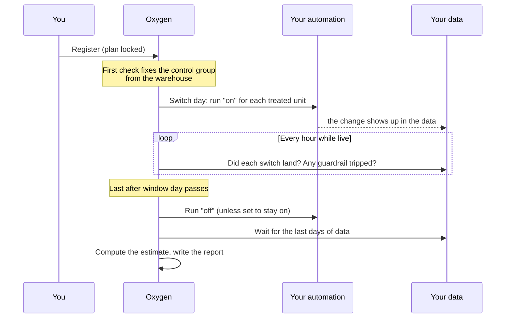
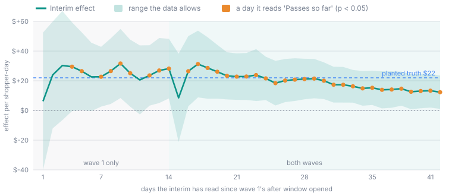
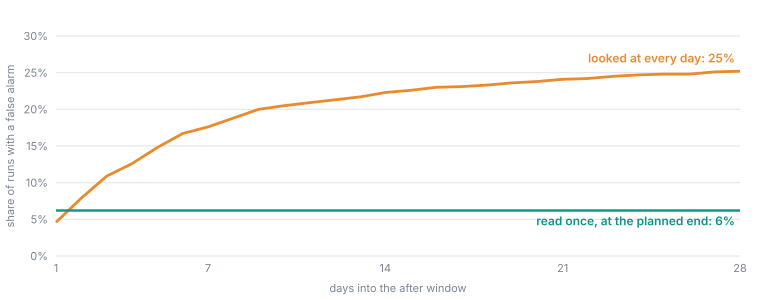

## Overview

Once a design is priced and used, the rest is largely automatic. You register
it, and from then on Oxygen acts **only on dates and guardrails**: it switches
the change on and off on the planned days, checks that each switch happened,
watches the safety limits, and closes the run when the last day has been
measured. Nobody edits a running experiment, and nothing happens because
someone looked at it.

## Registering

**Register** is available on a priced draft to workspace owners and admins.
The confirmation says it plainly: *"Registering is final: the design can no
longer be edited, and it cannot be undone. The platform starts flipping the
lever on schedule."*

Registration is refused unless:

- the draft has been priced and a design used, so it has a schedule, a seed
  and a promised detectable effect;
- the request arrives **before the registration deadline**: the start of the
  first switch day, less the anticipation buffer, in the design's time zone,
  by the platform's own clock (at [hour grain](/guide/build/world-model/experiments/grain#hour-grain-switching-at-any-hour),
  the switch hour less the buffer in hours);
- both lever automations still exist and are unambiguous (they may have been
  renamed since pricing);
- the draft is the one you were looking at (nobody saved over it in the
  meantime); and
- the experiment has no run yet. One experiment has one run.

### Why registration is the proof

The registration time is set by the platform's clock when the request
arrives, and from that moment the design is locked in the database: it cannot
be edited or deleted. Because that time must fall before the deadline, it
proves the design was written down before anyone could have seen it move.
Nothing about the plan can change afterwards, so the report a year later
grades the same plan.

To change a registered experiment, use **Duplicate as new draft**. The copy
is a new experiment with its own draft and, eventually, its own run.

<Note>
The automations and measures a design names stay in your workspace's files.
The lever automation is looked up by name each time it runs, so a broken
lever can be fixed mid-run. The report says if the lever's definition
changed during the experiment.
</Note>

## Fixing the control group

Shortly after registration, the first background check reads the warehouse
and fixes, once and for all:

- the **control group**: every unit with outcome data over the last
  before-window's worth of days that no wave names;
- for a **group** design, which units belong to which group;
- for a **switchback**, the fleet: the units with data in the last 28 days.

From then on these lists never change. A store that opens mid-run cannot
drift into the control group, and a product that moves category stays in the
group it was randomised with. If the warehouse returns nothing, nothing is
fixed and the next check tries again.

## Switching the change on and off

Oxygen's scheduler checks every experiment every few minutes, and also wakes
at the first moment of each switch and of the close in the design's time
zone: the start of the day, or at hour grain the switch hour itself.

When a switch is due it records one row per unit and switch, then runs your
automation: once per unit, or once per wave, depending on **How runs are
made**. Each row records which automation ran and which version of the
workspace it came from. The rows are unique per unit, state and switch
moment, so a repeated check can never switch a unit twice. For a switchback, every unit in
the fleet is switched at every period boundary. A period that has already
ended without its switch being sent is skipped rather than replayed late.

If a switch fails, Oxygen does not keep retrying it. The run is marked
failed, the owner is told once, and that unit counts as **not landed** in
the compliance record. The experiment carries on with the other units.

## Confirming each switch

The experiment's dates only mean something if the change really happened
then. So every hour, Oxygen reads your **Confirmed on when** and **Confirmed
off when** conditions from the warehouse:

- At each **treated** unit, from its switch day to the end of the grace
  period, the first day the on condition holds is recorded as the day the
  change landed. If the grace period ends with every day read and none holds,
  the switch is recorded as **not landed**.
- At each **control** unit, from the first switch to the last day measured,
  the off condition is checked. The first day it fails is recorded as the
  change **leaking** to a control.

At hour grain the same reading is done hour by hour, so the record says the
hour the change landed, and a switchback's 4-hour off period is judged on its
own 4 hours. The grace period is still counted in days.

<Warning>
Confirmation never moves a unit between groups. A store whose switch never
landed stays in the treated group in the analysis. This is called **intention
to treat**, and it is deliberate. The store whose till integration breaks is
more likely to be a badly run store, so dropping it would leave the treated
group full of well-run stores and manufacture an effect. Keeping every unit
where it was assigned keeps the comparison fair; the cost is that missed
switches water the effect down, which the report states as a restated
detectable effect.
</Warning>

## While the experiment is live

The page shows **operations only**:

| Tile | What it shows |
| --- | --- |
| **Flips confirmed** | Switches sent to your system and confirmed in the data, out of all switches owed so far. Each switch is shown as confirmed, pending, unconfirmed or failed. |
| **Treated compliance** | The share of treated units where the change has landed, against the floor. |
| **Data coverage** | The share of the latest window's days that have data, against the floor. |
| **Next switch** | The next date a lever is switched. |
| **Next check** | When the platform next reads the data and checks guardrails. |
| **Guardrails** | Each guardrail's state per unit: not checked yet, clear, breached, or could not be evaluated. |

At hour grain **Next switch** shows a date and an hour. A switchback also
shows its period schedule, and a group design shows which units belong to
which group. If the background scheduler has stopped, the page says **Not
advancing**: *"This experiment's scheduler isn't running — nothing will flip
until it is"*. Below the tiles sits the
[interim reading](#peeking-the-interim-reading).

### Why the result stays sealed

The **registered result** is sealed until the run reports. The page says
*"The registered result is sealed until the run reports; the interim below
is a peek, not the result"*, and the platform will not write a final result
for a live run: the request is refused on the server, not just hidden on the
page.

This is the single most important protection an experiment has. If you
check the number every day and stop as soon as it looks good, you will find
"effects" in pure noise far more often than the 1 in 20 you signed up for.
The test's guarantee only holds if it is read once, at the planned end.
Guardrails are the exception, because they look for harm, not for the
answer.

## Peeking: the interim reading

People still want to know how a run is going. A live or closing run therefore
shows an **interim reading**: the registered analysis, run over the days that
have finished so far, badged **Interim, not final**. It is a peek at the
direction and rough size of the effect, built so that it can never be
mistaken for the result or change what the run does.

### What it shows

The interim panel reuses the report's summary card and chart, with these
differences:

| Part | In the interim |
| --- | --- |
| Badge | **Interim, not final**, with an ⓘ that explains why checking early overstates confidence |
| Band across the card | *"INTERIM — not the final result: the registered estimator over the days read through (date), while the run is still in progress…"* |
| **Confidence** tile | *Passes so far* or *Misses so far*, with the p-value and the registered bar |
| **Read through** tile | The last whole day the interim read |
| Headline effect and interval | Shown, as in the report |
| **Total over treated units** and **Projection** | Not shown: both would extrapolate a run that has not finished |
| Predicted against measured, **Propose to semantic model** | Not shown: an interim never proposes a slope |
| Line under the badge | *Read through (date) · computed (time)*, and a **Refresh** button |

### When it is read

- **Once a day, automatically**, while the run is live.
- **On demand**, with **Refresh**, for workspace members and above (the same
  people who can price a design). Viewers see the latest reading but cannot
  start a new one. One reading runs at a time per run.
- **Only for live and closing runs.** Before the first switch nothing has
  been treated, and once the run reports the report is the reading. A
  [past-data analysis](/guide/build/world-model/experiments/past-data-and-few-units)
  goes straight to its report and has no interim.

The first reading appears once a whole day of the first after window has
finished; until then the panel says *"No interim yet. The first one is read
once a whole post-window day has finished; it refreshes daily."* If a reading
fails, the panel shows the reason as *Last attempt: …* and keeps the previous
reading.

### What it reads

The analysis refuses a window that is mostly missing, so it cannot be run on
an after window that is still in progress. The interim therefore reads a
**trimmed copy of the design**, cut at the start of today in the design's
time zone (at the current hour at hour grain, at the current week or month at
those grains):

1. **Waves** that have at least one whole after-window day are kept. Waves
   that have not reached their after window yet are left out, and their units
   are in neither group.
2. Every kept wave's after window is **shortened to the shortest one read so
   far**, so all waves are compared over the same number of days.
3. A **switchback** keeps only the on/off pairs that have finished.
4. The before windows, the washout, the blocks, the seed and the control
   group are the registered ones.

Then the registered analysis runs on that copy, unchanged. Nothing about the
interim is stored with the result, and it never touches the levers, the
run's state or the final report.

<Frame caption="The staggered promo from the worked examples, read as the interim reads it on each of 42 days. For its first 14 days only wave 1 has started, so the interim reads wave 1 alone. On day 15 wave 2's after window opens and every after window is cut to wave 2's single day, which is why the line dips. From there both waves are read over a lengthening window, and on the last day the interim reads +$12.30, exactly the final report's number.">
  
</Frame>

### Why an interim is a hint, not a result

The interval and p-value in an interim are the registered **fixed-horizon**
ones: they are correct for a test read once, at the end. Read every day, the
same test raises far more false alarms, because every reading is another
chance for noise to cross the bar.

<Frame caption="A panel shaped like the example shoppers, with no effect at all, run 1,000 times: 16 treated shoppers, 24 controls, a 28-day after window. Read once at the planned end, 6% of runs look significant at 0.05, close to the 5% promised. Looked at every day of the after window, 25% of runs look significant on at least one day: 18% within the first week.">
  
</Frame>

So a run that reads *Passes so far* on some day is not a finding. In the
promo above, the interim passed the bar on 36 of its 42 days, and its reading
moved between +$8 and +$32 against a final +$12.30. Use an interim to catch
something plainly broken, such as an effect in the wrong direction far
outside anything plausible, and to see that data is flowing. Do not stop a
run, or roll a change out, because an interim looks good: only the final
report is graded against the registered plan.

<Note>
Oxygen's analysis offers only fixed-horizon intervals today. A sequential
("always valid") interval that stays honest under repeated looks would let
an interim decide; it is not available, which is why the interim informs and
never decides.
</Note>

## Guardrails and aborting

### Guardrails

Every hour while the run is live, each guardrail is checked at every treated
unit that currently has the change on (for a switchback, at every unit during
"on" periods). Readings go up to yesterday, since today is not complete, and
they are daily readings whatever the experiment's
[grain](/guide/build/world-model/experiments/grain#what-stays-daily-and-why):
a guardrail cannot wait for a week or a month to finish.

- **A measure looks anomalous** compares each unit with its own normal
  range, using the same machinery as [anomaly monitors](/guide/build/world-model/metric-tree).
- **A condition holds** applies the threshold to each unit's latest day.

If **any one unit** breaches, the breach is recorded with the unit's name, and
the next scheduler pass aborts the run: it runs the off automation at every
unit that is on, cancels any switches not yet made, and notifies the owner.

Guardrails read the warehouse, so they are only as fast as your data. A
source that lands a day late can only show a breach a day late; pricing warns
about this.

### Aborting by hand

Workspace owners and admins can **Abort** a registered or live run. The
dialog asks for a reason, recorded with the run and on its report, and offers
two choices for the levers:

- **Turn levers off**: runs the off automation at every unit that is on now.
  Units not switched on yet are never switched on.
- **Keep levers as they are**: no off automation runs. The experiment stops
  managing every unit's lever, so turn them off yourself when you are done.

The first abort request wins, along with its lever choice. A guardrail breach
always turns the levers off. A run that has already reached closing can no
longer be aborted.

### What an abort means for the result

An aborted run is still analysed, but its measurement **stops at the start
of the day the abort took effect**, so no day after the change was turned off
is read as if it were on. At hour grain an abort part-way through a day
stops the measurement at the start of that day. The report is labelled
**ABORTED RUN — not the registered result**, with the reason and the cut-off
day. If the abort came
after the after windows had finished, the full measurement is read. If it
came early, the windows may be too short and the estimate will refuse.

## Closing

When the last after-window day has passed (at hour grain, the last
after-window hour), the run moves to **Closing**:

1. **The change is turned off**, unless **At close** says to leave it on. This
   happens on entering closing, not after the report, so a failed estimate
   can never leave the change running by accident.
2. **The carryover window is read**, if the design has one: Oxygen waits
   that many more periods after turning the change off.
3. **Oxygen waits for the data.** Warehouses lag, so closing waits until the
   last window's coverage reaches the floor, for up to **14 days** at every
   grain. If the data
   still has not arrived by then, it estimates on what is there and tells the
   owner. A window still below the floor is refused by the estimator rather
   than read as a shorter window.
4. **The estimate runs** in the background and writes the report. While it
   runs, the page shows **Preparing report**.

If the estimate fails, it is retried up to **three attempts** in all, each at
least an hour after the last failure. When the attempts are spent the owner
is notified once and the page shows *Estimate failed · attempt 3 of 3*.

When the report is written, the run becomes **Reported** (or stays
**Aborted**, with its labelled report). Continue with
[Reading the report](/guide/build/world-model/experiments/report).
