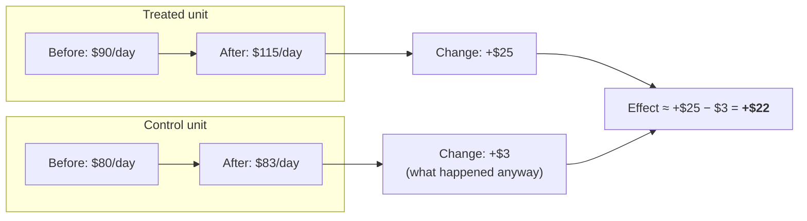
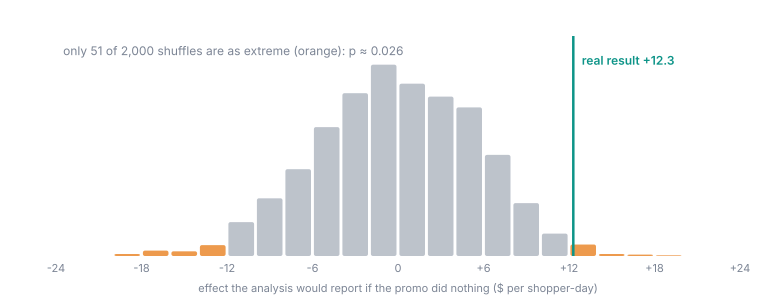
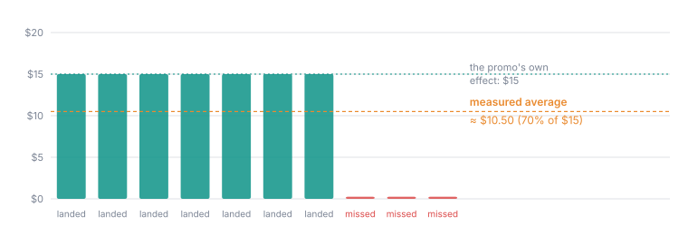

## Overview

This page explains what Oxygen computes, and why it is done this way rather
than the obvious way. Each section starts in plain words. The formulas sit in
folded sections for readers who want them, and nothing else on the page
depends on them.

## The core idea: compare changes, not levels

Treated and control units are rarely the same size. A big store sells more
than a small one whether or not it ran a promo. So comparing their sales
directly says little.

Instead, Oxygen asks **how much each unit changed**:

1. For each unit, take its average outcome per day **before** the switch and
   **after** it (leaving out the anticipation buffer and washout).
2. Subtract: that unit's change is *after − before*. **Each unit is now one
   number.**
3. Compare the average change of the treated units with the average change
   of the control units. The difference is the effect.

Anything that hit every unit in the after window, such as a holiday, the
weather or a price rise across the chain, shows up in both groups' changes
and cancels out. What is left is what the change added. This is called a
**difference in differences**.

<Frame caption="The staggered promo's first wave, one dot per shopper. The never-switched shoppers changed by −$0.80 on average, the wave-1 shoppers by +$15.40. The effect is the gap, +$16.30. Notice the spread: one treated shopper fell by $52, which is why the result comes with a range.">
  
</Frame>



### Why one number per unit matters

A store's sales on Tuesday look a lot like its sales on Monday. If you
analysed every store-day as a separate observation, the analysis would treat
56 days of one store as 56 independent pieces of evidence, when in reality
they are closer to one. It would then be far too confident, and declare
"significant" results routinely where there is nothing.

Collapsing each unit to one number avoids this entirely. The evidence is
counted in **units**, not days. That is also why a chain of 6 stores has an
effective sample of 6 however long it runs, and why the time to find that out
is at pricing, not after the run.

<Accordion title="The formulas: one switch date" icon="square-root-variable">
For unit `i`, with the outcome averaged over the retained days of each
window:

```
d_i      = mean(outcome_i | after window) − mean(outcome_i | before window)
estimate = mean(d | treated) − mean(d | control)
```

The two groups are compared with **Welch's t-test**, which allows the groups
to have different sizes and different spreads. The interval is
`estimate ± t_crit · se`, where `t_crit` uses Welch–Satterthwaite degrees of
freedom and the registered significance level, corrected for the number of
outcomes registered together (Šidák: `1 − (1 − α)^(1/k)` per outcome). With
one registered outcome there is no correction at all, which is the reward
for writing the plan down first. Units are matched to groups **by name**,
never by position, so the groups can never be silently swapped.

Blocks and matched pairs shape **the draw** on this path: they make a lopsided
split impossible. The analysis then compares the two groups as wholes. Under
blocked assignment that comparison is still unbiased, and its uncertainty is,
if anything, on the cautious side, so the benefit of blocking shows up as the
disastrous draws removed rather than as a narrower interval.
</Accordion>

## Staggered rollouts: each wave against units still waiting

With several waves, each wave is analysed on its own windows, against **only
the units that are still untouched for the whole of that wave's after
window**: units that never switch, plus units whose own switch (and
anticipation buffer) comes after it. The wave results are then averaged,
weighted by how many units each wave has.

The obvious alternative, one big regression over everyone with an
"already switched" flag, quietly uses units that switched earlier as controls
for later waves. When the effect differs between waves, that can give some
units negative weight and even flip the sign of the answer. Estimating wave
by wave against clean controls avoids the problem by construction.

### How the staggered result is tested

Waves share control units, so their results are not independent, and there
is no honest textbook formula for the uncertainty. Instead Oxygen uses a
**randomisation test**, which asks the question directly:

> If the change did nothing, and we had shuffled which units went in which
> wave, how often would we see a result at least this large?

It reshuffles the units across the actual wave structure, keeping the
calendar fixed and staying within blocks, and recomputes the result each
time. If the real result is more extreme than almost all shuffles, it is
significant. Because this mirrors exactly how the units were assigned, it
needs no assumptions about the shape of the data.

<Frame caption="The staggered promo, tested. Grey: the effect the analysis reports for 2,000 random reassignments of which shoppers were in wave 1, wave 2 or neither, as if the promo did nothing. Teal: the real result, +$12.30. Only 51 shuffles (orange) are as far from zero, so p ≈ 0.026.">
  
</Frame>

<Accordion title="Example: how the range is found" icon="flask">
To test whether the promo could have been worth, say, **$25**, Oxygen
subtracts $25 from each treated shopper's after window, as if the promo had
been worth exactly that, and runs the shuffle test again. If the adjusted
data now looks like pure noise, $25 stays in the range; if it still looks
extreme (now in the negative direction), $25 is ruled out. Searching up and
down this way gives the staggered promo's range: **$1.80 to $23.30**. $25 is
just outside it.
</Accordion>

<AccordionGroup>
  <Accordion title="The formulas: staggered estimate and test" icon="square-root-variable">
    ```
    ATT_g = mean(d | wave g) − mean(d | clean controls for g)
    ATT   = Σ n_g · ATT_g / Σ n_g
    ```

    A control is clean for wave `g` when it never switches, or when its own
    `switch − anticipation` falls on or after the end of wave `g`'s after
    window. A wave with fewer than 2 units, fewer than 2 clean controls, or a
    window under the coverage floor is dropped and reported.

    **The p-value.** Within each block, unit labels are reshuffled across
    the block's *permutation groups*: one group per observed switch day, plus
    the never-switched pool (a dropped wave keeps its own group). The number
    of distinct relabellings is the multinomial count over those groups,
    multiplied across blocks. Up to 20,000 relabellings are
    enumerated exactly; above that, 2,000 seeded shuffles are drawn and the
    p-value is `(1 + #{|null| ≥ |observed|}) / (1 + B)`. The decision is
    `p ≤ α`.

    **The smallest possible p-value** is `1 / (number of relabellings)`. If
    that is already above α, no result could ever be significant, and the
    design is refused at pricing. For example, two units per group gives only
    6 relabellings, which can never reach 5%.

    **The interval** is built by **test inversion**: a candidate effect `τ`
    is kept if, after removing `τ` from every treated observation in
    proportion to how much of its window was treated, the test does not reject.
    Each end of the interval is found separately by doubling and then
    bisection; if no candidate is ever rejected on a side, that side is
    reported as unbounded. The tempting shortcut, `estimate ± critical value
    of the shuffles`, is not used: on real effects it comes out about three
    times too wide.
  </Accordion>
</AccordionGroup>

## Switchbacks: a coin per pair

In a switchback, each pair of consecutive periods has one "on" and one "off"
half, chosen by a coin. For each period, Oxygen takes the fleet's average
outcome per unit-day over the period's days after the washout. Each pair
gives *on − off*, and the effect is the average of the pair differences.

The test asks: *if the change did nothing, and the coins had landed the other
way in some pairs, how often would the average be this large?* That is a
**sign-flip test**: every combination of flipped pairs is tried.

<Frame caption="The switchback example: four pairs, all positive (+14.4, +8.4, +12.6, +10.1), average +$11.40. Of the 16 ways the four coins could have fallen, only 'all on weeks higher' and 'all off weeks higher' are this extreme, so p = 2/16 = 0.125.">
  
</Frame>

<Accordion title="The formulas: switchback" icon="square-root-variable">
```
diff_p   = mean(outcome | on half of pair p) − mean(outcome | off half of pair p)
estimate = mean over pairs of diff_p
```

With `P` pairs there are `2^P` sign patterns (enumerated exactly up to
20,000, else 2,000 sampled). Because the patterns come in mirror-image
couples, the smallest attainable p-value is `2 / 2^P`. At α = 0.05 that
needs at least 6 pairs (`2/64 ≈ 0.031`); 5 pairs give `0.0625`. At α = 0.2,
4 pairs suffice (`0.125`). A pair with a period below the coverage floor is
dropped. The interval inverts the same test: candidate `τ` is subtracted from
every pair difference and kept while the test does not reject.
</Accordion>

## Groups of units

When units are grouped, for example by region, each group's day is the
**sum** of its members' outcome on that day, and the analysis runs on groups
exactly as it would on units. The effect is then per **group**-day, and the
sample size is the number of groups.

## Missing days and coverage

A difference in differences compares the same calendar days across units. So
a day that is missing for **any** unit is dropped for **all** units. Windows
are then measured in calendar days, not in surviving rows: a "56-day" window
with 14 days missing is not stretched to 70 days to make up the count. If a
window's share of days with data falls below the coverage floor, it is
refused rather than quietly shortened, because the measurement would no
longer be the one that was planned.

At week, month or hour [grain](/guide/build/world-model/experiments/grain)
everything above holds with "period" in place of "day": a week missing for
any unit is dropped for all, and a window counts calendar weeks. Each period
is numbered consecutively, so the analysis is the same at every grain. On a
measure that adds up, with data on every day, the effect per unit-week is 7
times the effect per unit-day over the same days.

## Compliance: why the effect gets watered down

Every unit is analysed in the group it was assigned to (intention to treat).
If the change only landed at some treated units, or leaked to some controls,
the measured effect is a blend of units that got the change and units that
did not.

<Accordion title="The formula: restated detectable effect" icon="square-root-variable">
With treated compliance `c_t` and control leakage `c_c`, the measured effect
is roughly `(c_t − c_c) ×` the change's own effect. So the design's promise is
restated as `MDE ÷ (c_t − c_c)`: at 67% net compliance, a design that could
detect 17.5 could only have detected a full-strength effect of about 26.
</Accordion>

<Frame caption="A promo worth $15 that landed at only 7 of 10 shoppers reads about $10.50: the three missed shoppers still count as treated.">
  
</Frame>

## The parallel-trends pre-check

The method assumes treated and control units would have moved together
without the change. Oxygen tests this on the before window, where nothing had
changed: it splits the before window into two halves and runs the same
analysis as if the change had happened at the midpoint. A significant fake
effect means the groups were already drifting apart. Staggered designs run the
check per wave.

The check can only find a problem; it cannot prove there is none. A short
before window gives it little power, which is one more reason to choose a
generous one.

<Frame caption="The local shock example. The before window's halves (grey, then orange) disagree because the treated shoppers jumped by $70 at the midpoint. The fake effect between the halves is +$55.90, nearly four standard errors: Diverged.">
  
</Frame>

## Cannibalisation: why the floor is wide

The neighbouring measure is analysed with the same method. To say how small
a loss could have gone unnoticed, Oxygen prices the neighbour's own detectable
effect on history from **before the first switch** (400 replays), so the
change itself cannot inflate it. That is the "not excluded above X" floor.

## The slope: outcome per unit of driver

When a driver is set, the experiment measures two effects: on the driver
(how far the lever pushed it) and on the outcome. Their ratio is the slope:
dollars of outcome per unit of driver.

<Accordion title="The formulas: Wald ratio and Anderson–Rubin interval" icon="square-root-variable">
```
slope = effect(outcome) / effect(driver)
```

A naive interval for a ratio breaks down exactly when the denominator is
uncertain. Instead, a candidate slope `β` is kept when the unchanged
estimator, run on `outcome − β · driver`, does **not** find an effect. The set
of kept values is the interval (an Anderson–Rubin set). When the lever barely
moved the driver, the set runs to infinity and is reported as unbounded,
which is the honest answer. The driver's own effect is tested at the
registered α as a diagnostic; it is not a registered outcome, so it does not
change the correction for multiple outcomes.
</Accordion>

## Totals and projections

The estimate is an **unweighted average effect per unit per day**. Three ways
of adding it up have very different standing:

| Adding up | Standing |
| --- | --- |
| **Up the metric tree**, such as from beverage revenue to total revenue within the same unit-days | Exact, because the tree's parts add up to the whole. |
| **Across the treated units**: average × units × days | Exact arithmetic: the average of a set times its size is its sum. |
| **Out to units that were never treated** | An **assumption** that the treated units represent the rest. Always labelled. |

For the projection, Oxygen checks whether unit size predicts the effect. It
measures each unit's size in a window that ends one window-length before the
before window, because correlating a unit's baseline with its own change
from that baseline manufactures a negative correlation out of nothing. It
then compares the treated units' size-effect correlation with the **control
units'** correlation, which carries the same statistical artefact and none of
the real effect. Only a significant difference between the two raises the
warning. Each unit is counted once, even when it controls for several waves.

## What none of this can fix

- **Results at other units.** The effect at the treated units need not hold
  elsewhere.
- **Parallel trends.** Checked, never proven.
- **Effects that differ between units.** The detectable effect assumes one
  effect for everyone. When it varies a lot, true power at the promised effect
  is lower than advertised.
- **Small samples.** The sample is the number of units, groups or pairs, not
  unit-days.

## How the method itself is tested

The statistics are calibrated by simulating whole experiments thousands of
times: a fresh panel each time, a known effect added to a randomly chosen
group, the real entry point run, and the results counted. The tests check the
false-alarm rate, the power at the promised detectable effect, and how often
the interval contains the true effect, for single-date, staggered and
switchback designs, with and without blocks. The tolerances are tight
enough to catch a method that promises 80% power and delivers 75%.
